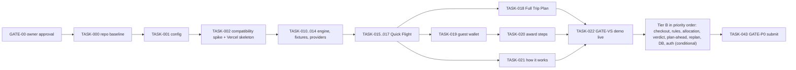

# Project B: A Una Milla. Master Plan (canonical entry point)

| Field | Value |
|---|---|
| Project | Hackathon 1, Project B: *A Una Milla de Tu Destino*, a travel-hacking savings planner (Spain-first, EUR, English P0 UI) |
| Status | Phase 1 and Phase 2 documentation complete. **Implementation started 27 Oct 2026 10:32 IST** (owner instruction). Real progress and test results are recorded only in `frontend/docs/implementation/EVIDENCE.md`; nothing counts as done without an entry there. |
| Corrections | [12 Pre-build corrections (27 Oct)](project-b/technical/12_PRE_BUILD_CORRECTIONS_2026-10-27.md) **override** docs 04, 05, 08, 09 and 11 where they conflict (cost model, objective-aware search, API status table, demo safety, readiness categories). |
| Date | Blueprint: Mon 26 Oct 2026. Build baseline: Tue 27 Oct 2026 10:32 IST (about 37.5 h to the deadline). |
| Deadline | Live URL + repositories by end of **Wed 28 Oct 2026** (assumed 23:59 IST, AS-27). 3-minute demo **Thu 29 Oct**. |
| Owner | Product owner (Rishi). Client: A Una Milla (Eriz). |

## 1. Product in one paragraph

A mobile-first web app that answers the brief's question, "How much could I save on this trip?", for a **Quick Flight** or a **Full Trip Plan**.
- It shows the normal price, the hacked price and the saving in € and %, and explains why. `[BRIEF]`
- It books a cash ticket in **Duffel test mode**, or gives ordered, guarded **award-booking steps**. `[BRIEF]`
- For users who want it, it plans ahead with existing points, cards and already-planned spending. It shows book-now-vs-wait verdicts and replans when life changes. `[OWNER]`
- Its governing rule is **P-01**: minimise necessary spending and realistic total trip cost, and earn only rewards that genuinely help this trip.
- In the hackathon every price is **Duffel test or illustrative fixture data**, so every saving is labelled **"Example saving (illustrative data)"**.

## 2. Document map

**Phase 1: requirements baseline (immutable)**
- [00 Product discovery and requirements](project-b/00_PRODUCT_DISCOVERY_AND_REQUIREMENTS.md) (87 requirements, formulas)
- [01 End-to-end user flows](project-b/01_END_TO_END_USER_FLOWS.md) (F01–F16, R1–R8, R-EV-01..14)
- [02 Edge cases and acceptance tests](project-b/02_EDGE_CASES_AND_ACCEPTANCE_TESTS.md) (161 edge cases, 181 planned tests, fixtures)
- [03 Product decisions and open questions](project-b/03_PRODUCT_DECISIONS_AND_OPEN_QUESTIONS.md) (decisions, compliance, 30 proposed plan updates)
- [Discovery audit report](project-b/DISCOVERY_AUDIT_REPORT_2026-10-26.md) · backups in `project-b/_backup/2026-10-26_pre-audit/`

**Phase 2: technical blueprint (this package)**
1. [Architecture and stack decision](project-b/technical/01_ARCHITECTURE_AND_STACK_DECISION.md)
2. [UI/UX and component specification](project-b/technical/02_UI_UX_AND_COMPONENT_SPECIFICATION.md)
3. [Domain model, database and migrations](project-b/technical/03_DOMAIN_MODEL_DATABASE_AND_MIGRATIONS.md)
4. [API contracts and provider integrations](project-b/technical/04_API_CONTRACTS_AND_PROVIDER_INTEGRATIONS.md)
5. [Savings engine and recommendation specification](project-b/technical/05_SAVINGS_ENGINE_AND_RECOMMENDATION_SPECIFICATION.md)
6. [Security, privacy and compliance](project-b/technical/06_SECURITY_PRIVACY_AND_COMPLIANCE.md)
7. [Testing and feature verification plan](project-b/technical/07_TESTING_AND_FEATURE_VERIFICATION_PLAN.md)
8. [Deployment, CI/CD, costs and upgrade path](project-b/technical/08_DEPLOYMENT_CI_CD_COSTS_AND_UPGRADE_PATH.md)
9. [Implementation roadmap and task breakdown](project-b/technical/09_IMPLEMENTATION_ROADMAP_AND_TASK_BREAKDOWN.md)
10. [AI tooling, Cursor, MCP and skills](project-b/technical/10_AI_TOOLING_CURSOR_MCP_AND_SKILLS.md)
11. [Traceability, decisions and final readiness gate](project-b/technical/11_TRACEABILITY_DECISIONS_AND_FINAL_READINESS_GATE.md)

**Relationship to the original Cursor draft**
- `C:\Users\vkapspc -15\.cursor\plans\project_b_planning_package_32a6e260.plan.md` is **preserved unchanged**.
- The 30 "Proposed Updates to Existing Project B Plan" in Phase 1 doc 03 §9 are **reconciled into this technical package**, not edited into the draft:
  - items 1–8, 11, 17, 22–25 → docs 05/09;
  - items 4, 12, 18, 26 → doc 03;
  - items 5, 14, 27, 29 → docs 06/02;
  - item 9 (renumbering) → resolved by the `technical/` folder;
  - items 16, 19, 30 → doc 07;
  - items 13, 20, 21 → doc 01 §5 / catalogue (D-27);
  - items 10, 15 → docs 02/09.
- **This master plan is now the canonical navigation point.**
- After TASK-000, this `docs/` folder is copied into the frontend repo, and that copy becomes canonical (D-32).

## 3. Selected technical approach

| Area | Decision | Status |
|---|---|---|
| Stack | **Option A: single Next.js 16.4.3 app** (Route Handlers + Server Actions) + pure TypeScript domain engine + provider adapters. NestJS rejected for the MVP; migration path documented. | ADR-001, PROPOSED |
| Repos | `frontend` = whole Next.js app (Vercel); `backend` = Supabase DB project (migrations, RLS, pgTAP, seed) | ADR-012 / D-31, PROPOSED |
| Hosting | **Vercel on the owner's account, non-commercial demo**; Netlify as fallback; Vercel Pro + Supabase Pro before any commercial use | D-30 **CONFIRMED** |
| Data | Supabase Postgres + Auth with explicit GRANTs + RLS on every table; **guest-only (browser-local) is the hackathon default** | D-29, PROPOSED |
| Live data | Duffel **test** only; awards and catalogue from fixtures and verified catalogue snapshots; Frankfurter as the external FX snapshot | D-19 CONFIRMED |
| AI in product | Templates; optional LLM behind a flag (off); a validator blocks new numbers | D-20 CONFIRMED |
| Versions | Exact pins + lockfile; TypeScript 5.9.3; "verified" only after the TASK-002 spike | ADR-011 |
| Free-first | Demo expected to cost **€0**; production roughly $45–91/month list price when needed (doc 08 §8) | — |

## 4. Implementation sequence (doc 09)

**Realism**
- Tier A (vertical slice) is about 26 h and Tier B about 37 h of estimated effort, against about 1.5–2 build days.
- **Only the vertical slice is targeted with confidence.** Tier B is done in priority order and stops where the evidence stops.
- The demo shows only features with recorded evidence.

**Per-task Definition of Done** (doc 07 §4):
1. format, lint and types;
2. targeted unit tests;
3. integration and DB tests where affected;
4. Playwright at 360/768/1280 with axe;
5. edge-case checks;
6. build;
7. a regression + deploy + smoke run at gates;
8. an evidence entry.

## 5. Acceptance gates

GATE-00 (owner approval) → GATE-01..07 (doc 11 §5) → GATE-VS (TASK-022) → GATE-P0 (TASK-043).

## 6. Decisions needed before implementation (doc 11 §2)

- **Must approve or accept defaults (hackathon):**
  - D-01, D-02, D-03, D-05, D-07, D-08, D-10, D-11, D-12, D-14, D-15 (P0 part), D-16, D-17, D-18, D-22, D-23, D-24, D-25, D-26, D-27, D-28;
  - **D-29** (guest-only default), **D-31** (two-repo split), **D-32** (docs location), **D-33** (demo URL environment).
- **Already confirmed:** D-04 (English P0; client confirmation open), D-19, D-20, D-21 (in principle), D-30 (Vercel on the owner's account).
- **Can wait until commercial launch:** D-06, D-09, D-13, D-15 (commission model), UNR-01..10, DPIA, paid tiers.

## 7. Blockers and unverified facts

**Owner actions**
- Approval (GATE-00..03).
- Git authentication for pushing to both repos (`gh` is not authenticated).
- Connecting Vercel to the frontend repo.
- Optional: a Duffel **test** token; a Supabase project + custom SMTP or GitHub OAuth.

**Tooling**
- The Supabase MCP is account-wide with write tools. It stays unused until scoped read-only, or remains disabled.

**Unverified facts**
- Duffel v2 order payload details and test-mode rate limit.
- eslint 10 + eslint-config-next compatibility (TASK-002).
- `@supabase/ssr` (beta) runtime behaviour in Next 16 (TASK-003).
- Iberia Aire cap scope, plus the other GAP-15..21 items in Phase 1 doc 02 §9.
- The organiser's deadline timezone.

**No real prices or bookings:** real-world prices, award availability and bookings are **not available**. The demo must not claim them.

## 8. Documentation consistency check (Phase 2 final gate)

Results of the read-only check run on 26 Oct 2026 are recorded in section 8.1 below. That check covers documentation consistency only; it says nothing about software behaviour.

### 8.1 Results

| # | Check | Result | Notes |
|---|---|---|---|
| 1 | All 11 technical docs + master exist; links resolve | **Pass** | 16 master links, 0 broken; 0 broken links inside technical docs |
| 2 | Every Phase 1 requirement is in the doc 11 matrix | **Pass** | 87 of 87; no extras |
| 3 | Every screen and flow has backend and data responsibilities | **Pass after fix** | First run: SCR-05, 12, 15, 16 had no backend/data mapping. Added doc 04 §7.1 (all 17 screens). DF-01..14 present. |
| 4 | Every table has an ownership/permission row and DB tests | **Pass** | 31 tables defined, 31 in the permission matrix; DB-001..018 referenced |
| 5 | Key worked-example values match Phase 1 doc 02 | **Pass** | 32 values (€50.14, 350/491/575, €78/10.0%, €1,674/57.7%, €718, €0.0091, €0.0079, €466.50 …) present in both |
| 6 | Every Tier A/B task has test commands and DoD | **Pass after fix** | TASK-013 and TASK-043 lacked explicit commands; added. 31 tasks; every TASK reference is defined. |
| 7 | Free-tier claims cite official, dated sources | **Pass after fix** | Doc 08 §10 added with 12 official links, rechecked 26 Oct 2026. Caveat: Netlify's "commercial use OK" source is a Nov 2024 post that predates its credit plans, so recheck before relying on it. |
| 8 | No secrets or tokens in docs | **Pass** | 0 matches for Supabase, Duffel, GitHub, AWS, OpenAI and JWT token patterns |
| 9 | No assumption shown as approved | **Pass** | Only D-00 (LOCKED), D-04, D-19, D-20, D-21, D-30 are CONFIRMED, all owner-stated; provisional parameters say "none is approved yet" |
| 10 | No test, integration or deployment claimed as executed | **Pass** | 0 claims; "verified in spike" appears only as a future status in TASK-002 |
| 11 | All 181 Phase 1 tests are mapped in doc 07 | **Pass** | 181 of 181; all cited T-, REQ- and EC- IDs exist in Phase 1 |
| 12 | Provider provenance and limits labelled; no award booking claimed | **Pass** | Doc 04 §3 provenance categories; §5 non-capabilities states no adapter books award tickets |

The first run also corrected a wrong label in doc 11 ("REC (30)" → 29; the total of 87 was already correct). **This gate checks documentation consistency only. No software has been built or tested.**

## 9. Build status (27 Oct 2026, evidence in `docs/implementation/EVIDENCE.md`)

| Tier / task | Status | Evidence |
|---|---|---|
| TASK-000..002 baseline, toolchain, compatibility spike | Done | ESLint 9.39.5 (template pin), TS 5.9.3; `pnpm verify` green |
| TASK-010..014 engine, fixtures, providers | Done | 68 Vitest tests (unit + MSW integration) |
| TASK-015..017 Quick Flight API, results, detail | Done | Playwright on 3 viewports |
| TASK-018 Full Trip Plan | Done | CS-05 e2e + bounded-search unit tests |
| TASK-019..021 guest wallet, award steps, how it works | Done | e2e + axe |
| TASK-030 test checkout (simulated / Duffel test) | Done for simulated; Duffel verified only via MSW | Integration + e2e |
| Backend DB (catalogue, user tables, RLS, RPC) | Done locally | 41 pgTAP tests, `db lint` clean |
| TASK-003 auth spike / `AUTH_MODE=supabase` | Not started | Guest mode only (D-29) |
| Plan-ahead, card allocation, verdict, replanning (Tier B) | Not started | Engine spec in doc 05 / doc 12 §B.8 |
| TASK-022 / TASK-043 deploy + smoke on a URL | **Blocked** | Push needs `gh auth login`; Vercel deploy needs the Git link or `vercel login` |

## 10. Exact next actions

1. **Owner:** run `gh auth login` (or tell me which credential to use), so I can push both repos.
2. **Then (agent):**
   - push `main` for both repos;
   - create a dedicated Vercel project (Hobby, non-commercial) linked to the frontend repo, with `AUTH_MODE=guest` and `PROVIDER_MODE=fixture`;
   - deploy a **preview** (protected by default; nothing in production);
   - run `BASE_URL=<preview> pnpm test:smoke`.
3. **Owner decision D-33:** whether the jury URL may be a public production domain of the demo project.
4. **Optional:** add a `duffel_test_` token in the Vercel env to show Duffel sandbox fares.
