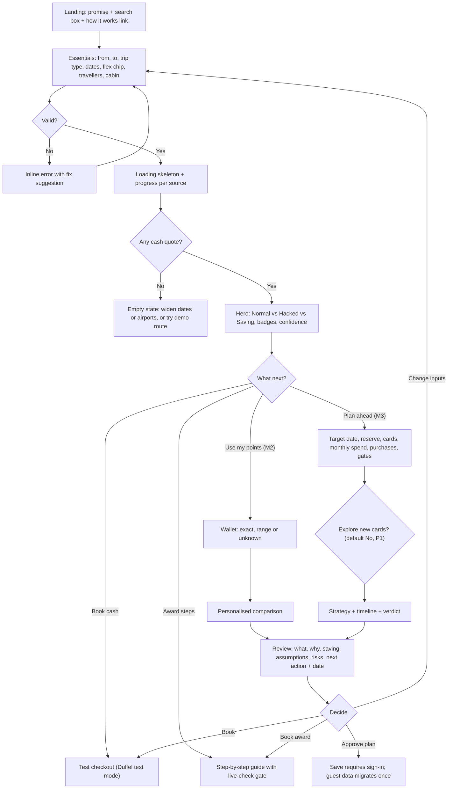
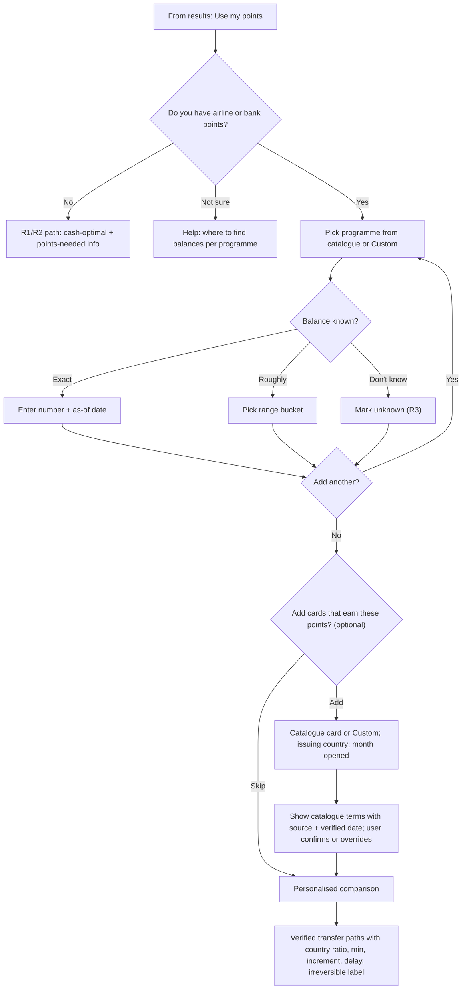
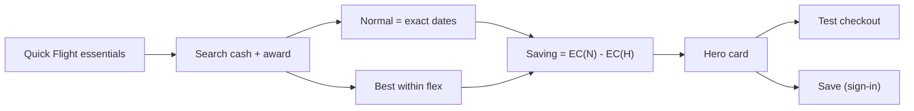
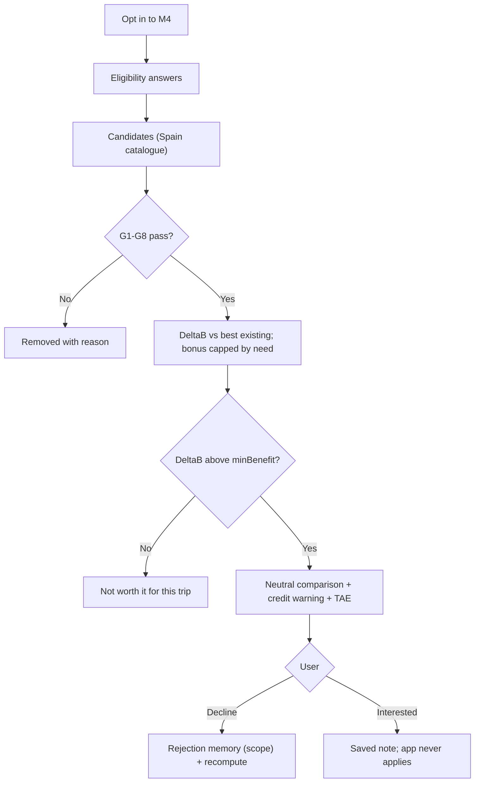
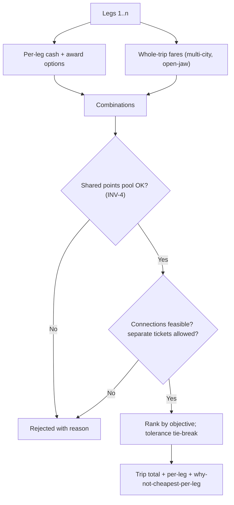
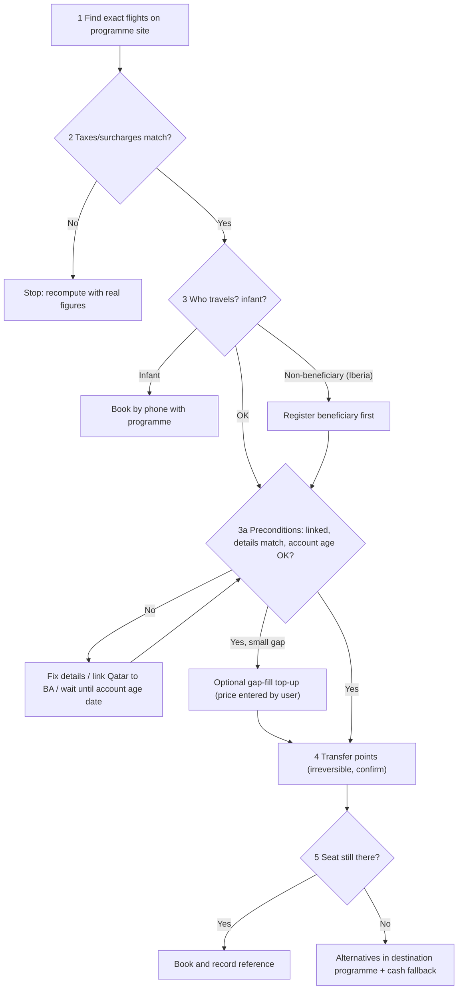
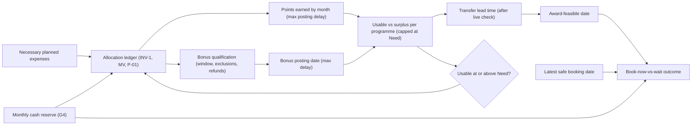
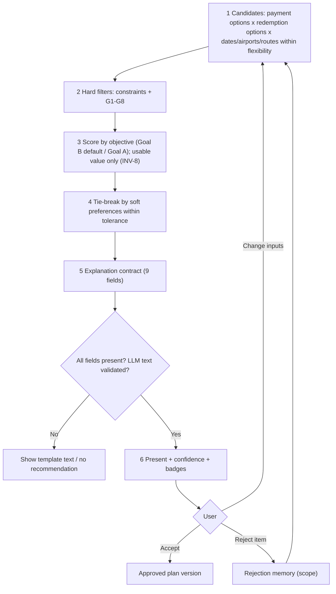
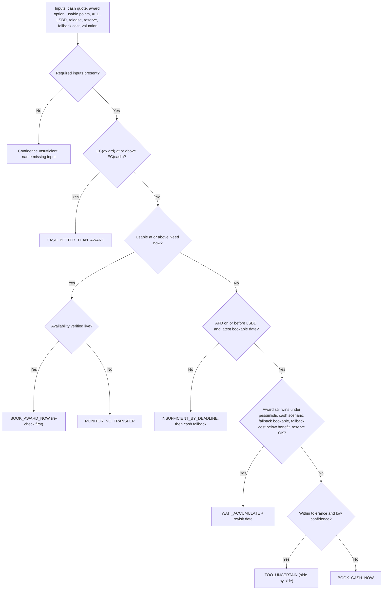
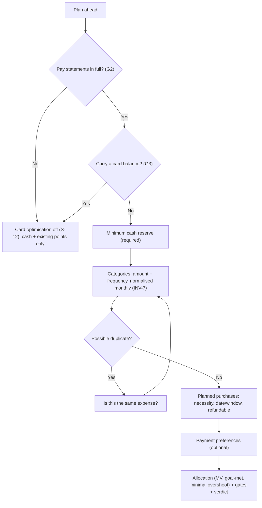

# Project B: A Una Milla. 01: End-to-End User Flows

| Field | Value |
|---|---|
| Phase | Phase 1: Discovery (no implementation) |
| Status | Draft for owner review, 26 Oct 2026. **Revised by the audit and correction pass** (see [DISCOVERY_AUDIT_REPORT_2026-10-26.md](DISCOVERY_AUDIT_REPORT_2026-10-26.md)). |
| Depends on | [00 Requirements](00_PRODUCT_DISCOVERY_AND_REQUIREMENTS.md): IDs Q-*, M1–M4, ST-*, G1–G8, INV-*, REQ-* |
| Tests and edge cases | [02 Edge cases and tests](02_EDGE_CASES_AND_ACCEPTANCE_TESTS.md) |
| Decisions | [03 Decisions and open questions](03_PRODUCT_DECISIONS_AND_OPEN_QUESTIONS.md) |

**Tags:** `[BRIEF]`, `[OWNER]`, `[RESEARCH]` and `[RECOMMENDATION]`, as defined in doc 00. Every recommendation flow below follows **P-01** (REQ-OWN-000): optimise the user's best outcome, never spending volume or gross points.

UI copy is in English (D-04). Quoted strings are proposed copy, not final.

---

## 1. Recommended first-time experience `[RECOMMENDATION]`

### 1.1 Why the proposed sequence was changed

The owner proposed a 10-step sequence:
1. understand the app;
2. start a trip;
3. essentials;
4. priorities and flexibility;
5. can we show something useful?;
6. offer points and cards;
7. optional spending;
8. personalised plan;
9. review;
10. choose next step.

I kept the steps but **re-ordered and gated them**. The main change is that a useful result appears **before** priorities, points, cards or spending are asked.

| Evidence | What it implies | Source (doc 03, section 6) |
|---|---|---|
| Upfront onboarding tutorials are "often skipped" and forgotten; contextual "pull" help works better | No questionnaire before value | NN/g, onboarding tutorials |
| Progressive disclosure: few options first; more than 2 levels is hard to use | Essentials first, "More options" second | NN/g, progressive disclosure |
| Only ask what you need; say why; allow "I do not know" | Every question has a "why we ask" line | GOV.UK question pages |
| Field count matters more than step count; unexpected extra costs drive about 39% of abandonment | Short form; all-in prices from the first view | Baymard |
| "An app that answers it in seconds, then lets you book" | Guest result first | `[BRIEF]` slide 52 |

The original step 4 (priorities) becomes a default (Goal B, with tolerance) that the user can change on the results page. The original steps 6–7 become opt-in modes M2 and M3.

### 1.2 First-visit flow

### 1.3 Screen-by-screen copy and behaviour (P0)

1. **Landing.**
   - Headline: "Same trip. Much less money." `[BRIEF]` tagline.
   - Sub-line: "See what you'd pay normally, what you could pay with points and smart routing, and exactly how to book."
   - Search box, a "How we calculate" link, and a "Try a demo trip" chip (demo fixtures, T-DEMO-001).
2. **Essentials** (Q-TRIP-01–07, plus the Q-FLEX chip "± 3 days").
   - Fields: from, to, trip type, dates, travellers, cabin.
   - The "Full Trip Plan" toggle opens the leg builder.
   - "More options" reveals Q-PREF and Q-FLEX-02/03.
3. **Searching.**
   - A skeleton result card, plus a line per source, e.g. "Cash fares: Duffel test ✓ · Award prices: demo data ✓".
   - Never a blank screen (B-9).
4. **Results (hero).**
   - Normal €X (all-in), Hacked (cash €Y + N points, or a cheaper cash option), Saving €Z (P%), and "cash you pay today".
   - **In the hackathon every hero reads "Example saving (illustrative data)"**, because all inputs are LIVE-TEST or ILLUSTRATIVE (REQ-RES-19). The calculation is tested; the prices are not real.
   - Badges show provenance; a chip shows confidence.
   - A one-line reason, then the ranked option list, plus the objective toggle "Lowest true cost | Pay least today".
5. **Personalise prompt**, inline under the hero rather than as a modal:
   - "Have points? Add them to see what you can book." → M2.
   - "Travelling in 3+ months? Build a plan." → M3.
6. **Review** (M2 and M3). Explanation contract fields in plain language, plus the next action and its date.
7. **Act.**
   - Book cash (test).
   - Follow the award steps.
   - Save the trip (sign-in).
   - Add a reminder (.ics).

---

## 2. Information architecture and screens

### 2.1 Navigation

The mobile bottom navigation becomes a left rail on desktop: **Search · Trips · Wallet · Plan · Settings**.

| Screen | Priority | Main content | Primary actions | Keeps work when leaving? |
|---|---|---|---|---|
| Landing | P0 | Promise, search, how it works, demo chip | Search, open demo | n/a |
| Quick Flight search | P0 | Essentials, flex chip, More options | Search | Draft autosaved locally (EC-ONB-06) |
| Full Trip Plan builder | P0 | Legs list (2–6), each leg's date, flex and cabin; travellers | Add/remove/reorder leg; search | Draft autosaved |
| Results | P0 | Hero comparison, ranked options, objective toggle, filters | Open option; book; save; personalise | Result cached with a timestamp |
| Option detail | P0 | Breakdown (fare, taxes, surcharges, points × value, fees), conditions (three-state), provenance, break-even, explanation contract, rejected alternatives | Book cash (test); award steps; set reminder | — |
| Award booking steps | P0 | Ordered steps with a live-check gate, irreversible-transfer confirmation, who-can-travel and infant branches, outcome recording | Mark step done; record booked/not booked | Progress saved |
| Test checkout | P0 | Passenger details (passed through, not stored), re-price, test order confirmation | Confirm; cancel | Offer expiry countdown |
| Wallet | P0 | Programmes as separate cards: balance (exact/range/unknown), as-of date, expiry, transfer paths; cards held | Add/edit balance; add card | Saved (signed-in) or local (guest) |
| Plan ahead (lite) | P0 | Target date, reserve, monthly spend by category, planned purchases, gate questions | Save; compute plan | Saved |
| Strategy and verdict | P0 | Book-now-vs-wait outcome, timeline (AFD, LSBD, release, revisit), points-goal meter (usable/needed), allocation per card with "next €1 earns", What changed | Approve; change; reject a suggestion | Plan version stored |
| Saved trips | P0 | List of trips with status (draft/planned/booked-test/cancelled), estimated total saved | Open; duplicate; archive | — |
| Settings and privacy | P0 | Valuation method, objective default, tolerance, consent, export, delete account, "How we calculate and rank", business-model note | Export JSON; delete | — |
| Card recommendations (M4) | P1 | Neutral comparison of new cards; credit warning and APR (TAE); eligibility answers; decline with scope | Decline (trip/all/until terms change) | — |
| Detailed spending and purchases | P1 | Per-category history, payment preferences, refund risk | Edit | — |
| Plan revisions | P1 (P0: latest diff only) | Version list, diffs, reasons, approvals | Restore draft; compare | — |
| Timeline and reminders | P1 (P0: in-app + .ics) | All dated actions, reminders | Snooze; complete | — |
| Price alerts | P1 | Thresholds | Create/edit | — |

### 2.2 Data-status labels (REQ-RES-17)

The UI must distinguish six kinds of data. Each label has a fixed style and text, and never relies on colour alone (T-A11Y-003).

| Label | Meaning | Example copy |
|---|---|---|
| `LIVE-TEST` | Fetched from Duffel test mode; **not a real market price** | "Test environment price – not a real fare" |
| `CACHED` | A previously fetched value | "Seen 25 min ago · Refresh" |
| `ILLUSTRATIVE` | A deterministic demo fixture | "Demo data – illustrative" |
| `ESTIMATE` | A future scenario | "Estimate (assumption: +15% price rise) – not a forecast" |
| `CONFIRMED BOOKING (TEST)` | Provider confirmed a test order | "Test booking confirmed · Ref ZZ123 · No real ticket" |
| `UNCONFIRMED OPTION` | An option not yet booked or held | "Not booked – price can change" |

**Availability states** (doc 00 §5.2a, added in the audit). These sit alongside the data labels: `VERIFIED_RESULT` (P2 only) · `TEST_OR_ILLUSTRATIVE` · `CACHED` · `NOT_YET_SEARCHABLE` ("Not bookable yet – planning with estimates") · `ESTIMATED_RELEASE_WINDOW` ("Award seats usually open around [date] – estimate, not confirmed") · `UNKNOWN_AVAILABILITY` ("Availability unknown – check the programme site"). There is no universal planning-horizon limit.

**Correctness vs provenance** (doc 00 §7.12): the engine's arithmetic is tested, but in the hackathon the prices are not real. Every saving is therefore an **"Example saving (illustrative data)"**. A LIVE-TEST cash price next to an ILLUSTRATIVE award price is labelled "illustrative pairing – not the same real flight", and confidence shows "Illustrative".

### 2.3 Standard states for every async view

Results, Option detail, Wallet, Strategy and Checkout each have every one of these states:

| State | Behaviour | Example copy |
|---|---|---|
| Loading | Skeleton plus progress per source; Cancel available | "Checking cash fares and award prices…" |
| Empty | Explain why, and offer two ways forward | "No flights found for these dates. Try ±3 days or nearby airports." |
| Partial | Show what arrived; flag what's missing; offer Retry | "Award prices unavailable right now – showing cash only. Retry" |
| Stale | Old data is shown greyed out with its age; Refresh | "These prices are 3 hours old. Refresh before booking." |
| Error | Human message, a way out, and an error ID | "Something went wrong on our side. Your trip is saved. Try again (ref E-4F2)." |
| Success | The result, with badges and confidence | — |

---

## 3. Cards and points onboarding (M2, plus the M3 card part)

**Rules**
- Programmes are always shown as separate currencies, with the note "We never add different points together" (REQ-OWN-02).
- Pooled family Avios can't be transferred (EC-CARD-20).
- Accounts less than 30 days old can't receive Avios moves (EC-CARD-19).
- Emirates via Amex Spain is labelled "suspended" (EC-CARD-10).
- **Avios move preconditions** (REQ-RES-20, added in the audit):
  - BA Club is usually the bridge.
  - Qatar must be linked to BA first (EC-CARD-22).
  - Name, date of birth and email must match (EC-CARD-21).
  - Accounts must be ≥ 30 days old, or 90 days for BA ↔ Iberia under BA's terms, using the stricter reading (EC-CARD-23).
- **Catalogue search uses canonical names and website aliases** (doc 00 §5.11), e.g. "Iberia Icon Aire" → Iberia Aire, "Zenit Gold" → Iberia Zenit.
  - Revolut asks for the plan **and** the card type (debit or credit).
  - Business cards (e.g. Amex Business Platinum) are only allocated expenses marked as business-eligible (EC-CARD-25).
- When the client guide and the issuer disagree, the issuer's terms are used and the difference is shown (EC-CARD-24).

**Which card attributes come from where**

| Attribute | Catalogue (with source) | User must supply | Changes over time |
|---|---|---|---|
| Product name (canonical + website aliases), issuer, rewards currency | ✓ | Plan and card type where rates differ (e.g. Revolut) | Rarely |
| Earn rates, categories, caps, steps, exclusions | ✓ | Confirms; overrides when terms are unclear | ✓ (stale badge after 30 days) |
| Annual or monthly fee, waivers | ✓ | Confirms | ✓ |
| FX fee and free allowance | ✓ | — | ✓ |
| Welcome offer terms | ✓ (snapshot; landing pages differ) | Which offer they actually got; window start; spend so far | ✓ often |
| Issuing country | — | ✓ | — |
| Month opened, statement day, credit limit | — | ✓ (optional) | — |
| Payment preferences | — | ✓ | ✓ |
| Card number, last 4 digits, CVV, bank login | **Never collected** | **Never** | — |

---

## 4. Refusal paths R1–R8 `[OWNER]` `[RECOMMENDATION]`

| Path | Situation | What the app still does | Calculations that become impossible | Assumptions it must not make | Copy |
|---|---|---|---|---|---|
| R1 | No credit cards | Cash comparison; flexible dates and airports; award options with points needed and break-even; ST-12 | Accumulation forecast; card allocation | That the user will get a card | "No cards needed – here's the cheapest way to fly." |
| R2 | Cards but no rewards | Same as R1. M4 only if the user opts in | Card allocation | That the cards earn anything | Same as R1 |
| R3 | Has rewards but doesn't know balances | Points needed per option; break-even v*; "How to check your balance" help | Affordability | Any balance value | "Add your balance any time to see if you can book this." |
| R4 | Won't share exact amounts | Range bucket gives affordability Yes / No / Maybe | Exact surplus; precise AFD | A midpoint as a fact | "Your range suggests you *may* have enough. Check before transferring." |
| R5 | No spending information | Existing points now, or cash | Forecast; welcome thresholds; AFD | Any spending level | "Without spending info we can only plan with points you already have." |
| R6 | Doesn't want a new card | M4 hidden; dismissal stored (trip / all / until terms change) | New-card strategies (ST-05) | That they'll change their mind | — (nothing shown) |
| R7 | Only wants a cash comparison | Google-Flights-style comparison, flexibility, nearby airports, all-in prices | All points strategies | That they hold points | "Cash only – switch on points any time." |
| R8 | Existing points and nothing else | M2 without M3/M4: existing balances, transfers, mixed by leg | Accumulation; cards | Future earning | "Using only the points you have today." |

---

## 5. End-to-end flows F01–F16

**Format:** each flow lists Entry · Required info · Optional questions · User decisions · System calculations · Constraints · Results shown · Alternative branches · Empty/error states · Recovery · Exit · Acceptance criteria · Edge cases · Tests.

**Fixtures** (FX-*, CS-*, S-*, M-*) are defined in doc 02, section 5. All values are ILLUSTRATIVE.

### F01: First-time user planning a simple cash flight (persona P-A, M1)

| Field | Specification |
|---|---|
| Entry | Landing → Quick Flight |
| Required | Q-TRIP-01–07 |
| Optional | Q-FLEX chip; Q-PREF-01/02 |
| User decisions | Accept the top option, open detail, book (test), or save |
| Calculations | N (exact dates), H across flex window, EC, savings; R1 path, since there are no balances |
| Constraints | All-in prices (REQ-RES-01); hard dates if set |
| Results | Hero with LIVE-TEST or ILLUSTRATIVE badge; award options show "points needed" and break-even only |
| Branches | Flex finds a cheaper date (CS-01: €78, 10.0%); flex finds nothing better ("Your dates are already the cheapest we found", EC-TRIP-01); nearby airport cheaper only before transport cost (EC-OPT-07) |
| Empty/error | No quotes → empty state with widen options; provider timeout → partial + retry (EC-TECH-01) |
| Recovery | Widen flex; change airports; try demo route |
| Exit | Test booking confirmed, saved trip, or leave (draft kept) |
| Acceptance criteria | Given CS-01 in demo mode, when searched, then hero shows "Normal €780 · Hacked €702 · Example saving €78 (10.0%) – illustrative data" with reason "Fly on [date+2], 2 days later" (T-FUN-031). Given no flex and no better option, then saving €0 is shown honestly. |
| Edge cases | EC-TRIP-01, 02, 13, 14; EC-OPT-07; EC-TECH-01, 04 |
| Tests | T-FLOW-001, T-FUN-001, T-CALC-004 |

### F02: User planning a trip with existing points (persona P-B, M2)

| Field | Specification |
|---|---|
| Entry | Results → "Use my points", or Wallet |
| Required | At least one programme, with balance exact / range / unknown |
| Optional | Cards; issuing country; valuation method |
| User decisions | Choose an award or cash option; open award steps |
| Calculations | Usable points via the verified graph (country ratio, minimum, increment); EC with user valuation; break-even; Goal A vs B ranking |
| Constraints | No transfer before live check (REQ-RES-08); programmes never summed |
| Results | Per option: cash you pay, points used, economic saving, affordability (Yes/No/Maybe/Unknown) |
| Branches | Award worse than cash (CS-04 → "Cash is better by €98"); enough points (CS-03); partly enough (CS-02, corrected: "Not bookable with your current points", gap shown, H stays cash; options are plan ahead (M3) or a gap-fill top-up **only after confirming the seat**, CS-02b / REQ-REC-BUY-01); unknown balance (R3) |
| Empty/error | No award options → "No award prices for this route in our data" + cash (EC-OPT-05) |
| Recovery | Change cabin or dates; add balance; switch valuation |
| Exit | Award steps started; cash booked (test); saved |
| Acceptance criteria | Given CS-04 and Goal B, then cash ranks first and the award shows "economic cost €718 vs €620; worth it only if you value points above €0.0091". Given Goal A, then the award ranks first with that note. |
| Edge cases | EC-CARD-04, 05, 07, 10; EC-OPT-01, 12 |
| Tests | T-FLOW-002, T-CALC-106, T-CALC-012 |

### F03: User with multiple cards and loyalty currencies (persona P-B/P-D, M2→M3)

| Field | Specification |
|---|---|
| Entry | Wallet → Add card / Add programme |
| Required | Each programme separately; each card's catalogue entry or a custom entry; issuing country |
| Optional | Payment preferences (Q-CARD-08); statement days |
| User decisions | Confirm or override terms; set trip priority if several trips compete for points (INV-4) |
| Calculations | Transfer graph; usable vs surplus per programme; allocation with MV (M3) |
| Constraints | INV-1–8; P-01 |
| Results | Wallet shows separate programmes; trip shows the "Points goal" meter |
| Branches | MR (Spain) → Iberia 1:1 vs MR (NL) → 3:2 (T-CALC-010); Emirates path suspended; points needed by two trips → priority prompt |
| Empty/error | Missing catalogue card → Custom (EC-CARD-01); conflicting terms → restrictive reading + banner (EC-CARD-03) |
| Recovery | Edit terms; set priority |
| Exit | Wallet saved; plan recomputed |
| Acceptance criteria | Given MR 45,000 (ES) and Avios 12,000, then the wallet never shows 57,000 as one balance; the award detail shows "12,000 Avios + 45,000 MR transferable 1:1 (irreversible)". |
| Edge cases | EC-CARD-01, 03, 07, 10, 19, 20; EC-ALLOC-04 |
| Tests | T-FLOW-003, T-CALC-010, T-ALLOC-004 |

### F04: User willing to consider a new card (persona P-D, M4, **P1**)

| Field | Specification |
|---|---|
| Entry | Strategy → "Explore new cards (optional)" |
| Required | Explicit opt-in; issuing country; prior-holder answers for the lookbacks (e.g. "held any Amex in the last 12 months?") |
| Optional | Comfortable spend range; credit limit |
| User decisions | View comparison; decline (scope); mark interest |
| Calculations | ΔB vs best existing alternative (section 7.5 of doc 00); bonus value limited by need; fee pro-rated over the horizon (D-09); gates G1–G8 |
| Constraints | Neutral comparison; credit warning + APR (TAE); no "advice" wording; no "approval odds"; no affiliate links (REQ-RES-16) |
| Results | Cards ranked by ΔB, with the explanation contract incl. rejected alternatives; "Not worth it for this trip" shown when ΔB ≤ minBenefit |
| Branches | S-02b (fee outweighs: −€8.00); S-09 (bonus too late: residual only); S-13 (ineligible) |
| Empty/error | No eligible card adds value → "Your existing cards already do the job." |
| Recovery | Decline; return to plan |
| Exit | Declined (stored) or "interested" (no application is made by the app) |
| Acceptance criteria | Given S-02b, then the card shows "€52 bonus value − €60 fee = −€8 over 12 months: not recommended". The credit warning and TAE are visible on the card view. |
| Edge cases | EC-CARD-15, 16; EC-RWD-09, 15 |
| Tests | T-CALC-104, T-FUN-025, T-CALC-108 |

### F05: User refusing all new-card recommendations (persona P-E/P-F)

| Field | Specification |
|---|---|
| Entry | Settings → "Never suggest new cards", or Decline with scope "all trips" |
| Required | — |
| User decisions | Scope: this trip / all trips / until terms change |
| Calculations | Recompute without ST-05 |
| Results | Rejected products appear only under "rejected alternatives" as "you declined" |
| Branches | "Until terms change" + opt-in → a single notice when an offer snapshot changes materially (fee or bonus) |
| Empty/error | — |
| Exit | Plan recomputed |
| Acceptance criteria | Given scope "all trips", when any trip is computed, then no new-card suggestion is shown and the plan is identical to a run with M4 disabled. |
| Edge cases | EC-CARD-16, 17 |
| Tests | T-FLOW-109, T-FUN-028 |

### F06: User who shares no spending information (persona P-F)

| Field | Specification |
|---|---|
| Entry | Plan ahead → "Skip spending" |
| Required | — |
| Calculations | R5: existing points now, or cash; no AFD |
| Results | Verdict uses only current usable points; "Planning with points you have today" |
| Branches | With unknown balances as well (R3 + R5) → affordability "Unknown", break-even shown (T-CALC-110) |
| Exit | Plan saved without a forecast |
| Acceptance criteria | Given no spending and no balances, then no forecast, no card allocation and no new-card prompt appear, and the verdict is one of `BOOK_CASH_NOW`, `CASH_BETTER_THAN_AWARD` or `TOO_UNCERTAIN`. |
| Edge cases | EC-ONB-01, 07; EC-CARD-05 |
| Tests | T-FLOW-006, T-CALC-110 |

### F07: User planning a trip a year ahead (persona P-D, M3)

| Field | Specification |
|---|---|
| Entry | Plan ahead with a target date about 12 months out (e.g. MAD→PEK, business) |
| Required | Target date + firmness; reserve; gate questions; balances (or unknown) |
| Optional | Monthly spend; purchases; cards |
| Calculations | Per-programme **estimated** release window (e.g. about 355–360 days for Iberia/BA, AS-03, SECONDARY; `UNKNOWN_AVAILABILITY` if no estimate). There is **no universal horizon limit** (corrected in audit). Also LSBD; AFD; scenarios; revisit dates. |
| Constraints | Search beyond provider horizons → "prices not yet published; we'll remind you on [date]" |
| Results | Timeline: today → release date (estimated) → AFD → LSBD → departure; verdict, usually `MONITOR_NO_TRANSFER` or `WAIT_ACCUMULATE` this far out |
| Branches | Visa notice for China (policy currently ends 31/12/2026; check before travel, REQ-RES-18); Iberia doesn't fly its own aircraft to mainland China (codeshare), so an Iberia chart price is not assumed |
| Empty/error | No cash quote that far ahead → indicative-only state |
| Recovery | Revisit reminder (.ics) |
| Exit | Plan approved and saved |
| Acceptance criteria | Given departure in 12 months, then the timeline shows the estimated release date with an "estimate, not confirmed" label and a reminder 7 days before it. Given departure in 500 days (V10), then planning works, the award is `ESTIMATED_RELEASE_WINDOW`, cash is `NOT_YET_SEARCHABLE`, and the verdict is `TOO_UNCERTAIN` (T-TIME-012). |
| Edge cases | EC-TRIP-15, 18; EC-OPT-17 |
| Tests | T-FLOW-007, T-TIME-010 |

### F08: User with flexible dates and airports (persona P-A, M1)

| Field | Specification |
|---|---|
| Entry | Essentials → flex chip or More options |
| Required | Flex value per date; firmness; airport mode |
| Optional | Ground transport cost and time for nearby airports |
| Calculations | N = exact; H = best within window and airports; transport cost added to cashOut |
| Constraints | Caps per flex type; hard firmness; Q-FLEX-03 limits |
| Results | Date grid (all-in prices only), airport alternatives with transport line |
| Branches | Nearby airport cheaper only without transport → shows "transport cost not included" and can't be the top Goal B pick unless the saving exceeds AS-09 (EC-OPT-07); cheaper date conflicts with hard date → hidden (EC-OPT-08) |
| Empty/error | Window too large → "That's about 200 searches; narrow to ±3 days or pick a month" |
| Exit | As F01 |
| Acceptance criteria | Given BCN alternative €735 + entered train €60 = €795 vs MAD €780, then MAD is recommended and BCN is listed as "€15 more after transport". |
| Edge cases | EC-TRIP-01, 08; EC-OPT-07, 08 |
| Tests | T-FLOW-008, T-CALC-013 |

### F09: User optimising a multi-city itinerary (persona P-D, M1/M2)

| Field | Specification |
|---|---|
| Entry | Full Trip Plan builder |
| Required | 2–6 legs; travellers; cabin (per leg optional) |
| Optional | Balances; open-jaw allowed; self-transfer allowed |
| Calculations | Per-leg options + whole-trip fares; combinations under the shared points pool (INV-4); connection feasibility; N for multi-leg (doc 00, section 7.2) |
| Results | Per-leg table + trip total; chosen combination; "Why not the cheapest per leg?" panel |
| Branches | CS-05: the cheapest per-leg (both awards) is infeasible with 30,000 points → open-jaw cash €970 chosen, saving €0 (honest), with the note that a naive "sum of one-ways" normal price (€1,150) would have inflated the saving |
| Empty/error | A leg without quotes → partial result; trip total marked incomplete (EC-TECH-04) |
| Recovery | Edit leg; allow open-jaw; add balances |
| Exit | Save; per-leg award steps and/or cash test booking |
| Acceptance criteria | See REQ-BRF-02 AC-1. |
| Edge cases | EC-TRIP-03, 05, 07, 20; EC-OPT-06, 09, 18 |
| Tests | T-FLOW-009, T-CALC-007 |

### F10: Initial plan depends on future accumulation (persona P-D, M3)

| Field | Specification |
|---|---|
| Entry | Strategy after Plan ahead |
| Required | Monthly spend; cards held; reserve; gates G2/G3 = OK |
| Calculations | The allocation ledger: points by month (max posting delay) → bonus qualification and posting → usable balance → transfer lead → AFD vs LSBD → verdict (section 7, the dependency chain) |
| Constraints | P-01 (MV, goal-met, minimal overshoot); G1–G8; INV-1–8 |
| Results | Points-goal meter; monthly projection (ESTIMATE); allocation per card with "next €1 here earns X usable points (€Y)"; verdict, e.g. `WAIT_ACCUMULATE` with revisit date |
| Branches | 6-month worked example (doc 02, section 3.2): v=0.012 → `CASH_BETTER_THAN_AWARD`; v=0.008 + cut-off 30 days → `INSUFFICIENT_BY_DEADLINE`; cut-off 14 days → `WAIT_ACCUMULATE`; cheaper cash in month 3 → `BOOK_CASH_NOW` |
| Empty/error | Missing reserve → can't compute ("Enter a minimum cash reserve to plan ahead") |
| Exit | Plan approved; reminders created |
| Acceptance criteria | Given the 6-month example with v=0.008 and a 14-day cut-off, then the verdict is `WAIT_ACCUMULATE`, with revisits every 30 days (including day 90, month 3) and a key check on day 142 (AFD − 7), and invalidating events are listed. |
| Edge cases | EC-OPT-11, 19, 20; EC-RWD-20 |
| Tests | T-TIME-001–004, T-FLOW-010 |

### F11: User adds an iPhone purchase after planning (persona P-D)

| Field | Specification |
|---|---|
| Entry | Plan → Purchases → Add "iPhone, €1,200, shopping, necessary, date" |
| Calculations | R-EV-01 (section 6): reserve check per month; allocation (MV); threshold effects; AFD and verdict deltas |
| Results | "What changed" card (section 7) |
| Branches | The purchase helps reach a planned threshold (necessary + eligible + in window) → bonus may qualify; it breaks the reserve (G4) → plan flagged (S-11 / T-CALC-113); it pushes usable past need → goal met, so remaining expenses are routed for cash value (M-04) |
| Exit | User accepts the new version or keeps the previous one (the purchase stays recorded either way) |
| Acceptance criteria | See T-REG-107. The approved version is unchanged until accepted. |
| Edge cases | EC-SPD-06, 09; EC-ALLOC-09 |
| Tests | T-REG-107, T-FLOW-011, T-CALC-113 |

### F12: Points expire, or a card bonus deadline changes

| Field | Specification |
|---|---|
| Entry | Daily check (system) or user edit |
| Calculations | Expiry rule per programme (REQ-RES-09); bonus window recompute; AFD |
| Results | Warning with an activity hint (Avios: earning or redeeming counts; programme-to-programme transfers do not; Avios Wallet linking counts) |
| Branches | Expiry before LSBD → points become surplus (0 for trip) unless activity happens; bonus window shortened → S-08/T-TIME-112 path |
| Exit | User acknowledges; plan recomputed |
| Acceptance criteria | Given Avios inactive 34 months and departure in 4 months, then the warning appears and those Avios are excluded from usable points after the expiry date. |
| Edge cases | EC-CARD-06, 11; EC-RWD-12, 13 |
| Tests | T-FLOW-012, T-TIME-008, T-TIME-112 |

### F13: User gets a better fare, or loses award availability

| Field | Specification |
|---|---|
| Entry | The user refreshes, or a monitoring event (P1) |
| Calculations | R-EV-12 (award lost) or new cash quote; verdict recompute |
| Results | "Cash dropped to €690 – booking cash now beats waiting (€720 award economic cost)" or "The award seat is no longer shown – cash fallback: …" |
| Constraints | If a transfer has already been made, the points stay in the destination programme (irreversible); show alternatives within that programme |
| Exit | Book cash (test) or keep monitoring |
| Acceptance criteria | Given the 6-month example and a cash fare of €690 observed at month 3, then the verdict becomes `BOOK_CASH_NOW`. |
| Edge cases | EC-OPT-03, 10, 19; EC-CARD-09 |
| Tests | T-FLOW-013, T-TIME-004, T-REG-012 |

### F14: User chooses a cash ticket after rejecting an award option

| Field | Specification |
|---|---|
| Entry | Option detail → "Not this award" → Choose cash |
| Calculations | Rejection recorded for this option; recompute with ST-12 |
| Results | Cash option detail; points stay unspent and are shown as kept for later |
| Exit | Test booking confirmed |
| Acceptance criteria | Given the user rejects the award, then the cash checkout opens with the re-priced offer and the award no longer appears as recommended for this trip. |
| Edge cases | EC-OPT-01; EC-TECH-03, 17 |
| Tests | T-FLOW-014, T-INT-004 |

### F15: User completes an award booking through external instructions

| Field | Specification |
|---|---|
| Entry | Option detail → "How to book with points" |
| Required | Who is travelling (member / beneficiary / companion); infants? |
| Calculations | Steps tailored by programme and branch |
| Results | Ordered steps (REQ-BRF-05): 1. Search the programme site for exact flights. Seats.aero or SeatSpy can speed this up (CG-3). 2. Confirm taxes and surcharges match €Y. If not, stop and recheck. 3. Check who can travel. 3a. Check the transfer preconditions: bridge account, linked accounts, matching details, account age (REQ-RES-20). An optional gap-fill top-up is offered here only if the gap is ≤ 20% and the user entered a price (REQ-REC-BUY-01). 4. **Only then** transfer N points (irreversible; tick to confirm). 5. Book. 6. Record the outcome (booked with ref / not available / price differed). |
| Branches | Infant → "Infant award tickets must be booked by phone with [programme]" (REQ-RES-04); non-beneficiary on Iberia → "Add them as a beneficiary first" (REQ-RES-05); seat gone after transfer → cash fallback plus alternatives within the destination programme (EC-OPT-03) |
| Exit | Outcome recorded → R-EV-11 (booked) |
| Acceptance criteria | Given an award option, then step 4 can't be marked done before steps 1–2; recording "booked" marks the leg as protected in the plan. |
| Edge cases | EC-TRIP-16, 17; EC-CARD-08, 09; EC-OPT-03 |
| Tests | T-FLOW-015, T-FUN-004, T-FUN-017–019 |

### F16: User returns to an existing trip and updates the plan

| Field | Specification |
|---|---|
| Entry | Saved trips → open trip |
| Calculations | Staleness check: quotes older than their TTL are marked `CACHED`/stale; rules past their verification window get a badge; balances older than 30 days → "check your balance" |
| Results | Current approved plan + "Things that may have changed since [date]" + Refresh |
| Branches | Edit dates or destination (R-EV-08/09) → new draft; protected booked legs remain |
| Exit | New version approved or kept |
| Acceptance criteria | Given a trip saved 10 days ago, when opened, then all prices show their age and the verdict is labelled "based on prices from [date]" until refreshed. |
| Edge cases | EC-TECH-05; EC-ONB-06; EC-TRIP-11, 12 |
| Tests | T-FLOW-016, T-REG-008, T-REG-009 |

---

### REF-01 walk-through: the client consultation (Madrid → Johannesburg, Business) `[CLIENT-GUIDE]`

This applies flows F02, F03 and F15 to the community's own consultation example. The numbers are in doc 02 §4.4, all ILLUSTRATIVE. The client's cards and preferences are **not** assumed for anyone else.

| Step | What the user does | What the app does |
|---|---|---|
| 1 | Enters MAD → JNB, Business, "book within 90 days" (hard booking deadline) | Quick Flight result: "Example saving (illustrative data)"; LSBD = day 87 |
| 2 | Adds balances: Revolut Ultra 60,000 RevPoints; Amex Business Platinum 30,000 MR; Iberia, BA and Qatar accounts (Qatar opened 10 days ago) | Shows separate currencies and verified paths (Revolut → Iberia/BA/Qatar; Business MR → Iberia). Flags "Business MR → BA unverified". |
| 3 | Compares options | IB-ILL is affordable (90,000 vs 88,000 buffered). QR-ILL is cheaper (EC €1,100 vs €1,250) but only "Maybe" (90,000 vs 93,500 buffered). Verdict `MONITOR_NO_TRANSFER`. |
| 4 | Opens "How to book with points" | Step 1: search live seats first (Seats.aero / SeatSpy). Step 3a: link Qatar ↔ BA, check details match, wait until the Qatar account is 30 days old (day 20). |
| 5 | Finds a live price of 92,000 on Qatar | Gap 2,000 points (2.2%). A top-up is offered only if the user enters a price; then transfer, then book. |
| 6 | Records "booked" | Leg protected (R-EV-11); remaining points shown as kept |

Tests: T-CALC-024, T-FUN-032.

## 6. Dynamic replanning (R-EV-01 to R-EV-14) `[OWNER]` `[RECOMMENDATION]`

For every event:
- the new draft plan version is computed against the **approved** version;
- protected items are never changed without explicit approval;
- approval is **always** required if an approved action or a booked leg would change, and otherwise optional (an informational diff).

| Event | 1. Stored data change | 2. Stale calculations | 3. Recalculated | 4. Still valid | 5. Protected | 6. Comparison | 7. Explanation | 8. Approval |
|---|---|---|---|---|---|---|---|---|
| R-EV-01 Add one-off purchase (e.g. iPhone) | New planned expense (necessity, date, refund) | Reserve per month, allocation, thresholds, AFD | Allocation (MV), gates, bonus, AFD, verdict | Quotes, transfer graph | Booked legs, approved transfers | Old vs new per dependency link | "Adding €1,200 changes…" | Required if verdict or approved allocation changes |
| R-EV-02 Remove or refund purchase | Status → refunded/cancelled; negative ledger entry (INV-6) | Threshold spend, earned points | Bonus qualification (clawback risk), balance, AFD | Quotes | Booked legs | Bonus status before/after | "A €40 refund drops qualifying spend to €260…" (S-10) | Required if bonus or verdict changes |
| R-EV-03 Change monthly spending | Category amount (normalised, INV-7) | Forecast, allocation | Allocation, AFD, verdict | Quotes, balances | Booked legs | Points by month before/after | "Groceries down €100/month → goal reached 1 month later" | Required if verdict changes |
| R-EV-04 Update points balance, or record points actually posted (corrected in audit) | Balance, as-of date; actual posting for card and month | Usable/surplus, affordability, that month's estimate | The actual replaces the estimate (REQ-REC-FCST-01); future months re-projected; usable; goal-met status; verdict | Allocation (unless goal-met changes) | Booked legs | Usable before/after; actual vs estimate | "Card posted 260 points (we estimated 233)" / "You now have enough – we've stopped chasing points" | Required if verdict changes |
| R-EV-05 Add or remove card | Card record + rules | Allocation, MV | Allocation, ΔB, gates | Quotes | Booked legs; in-progress bonus warnings | Allocation diff | "Removing Card T ends its bonus in progress (−€50)" | Required |
| R-EV-06 Reject card recommendation | Rejection memory (scope) | Strategy set | Recompute without product | Everything else | — | Plan vs plan-without-product | "Removed at your request" | Not required (informational) |
| R-EV-07 Verified transfer bonus or terms change | New rule snapshot | Points cost via path, ΔB | Affected options, verdict | — | Completed transfers | Effective cost before/after | "A +20% transfer bonus lowers the points needed via Revolut…" | Required if verdict changes |
| R-EV-08 Change destination or cabin | Trip/legs | All quotes for affected legs | Search, N/H, verdict | Unaffected legs | Booked legs (never altered) | Trip totals before/after | "New destination: previous quotes no longer apply" | Required |
| R-EV-09 Move dates | Dates, flex | Quotes, LSBD, AFD, windows | Search, LSBD, AFD, verdict | Balances, allocation (until LSBD shift matters) | Booked legs | Timeline diff | "Departure moved 2 weeks later: LSBD now [date]" | Required |
| R-EV-10 Change budget or reserve | Profile/trip | Gate G4, budget filters | Gates, allocation, verdict | Quotes | Booked legs | Reserve per month | "New reserve €2,000 → pull-forward no longer possible" | Required if any strategy is removed |
| R-EV-11 Book or cancel a flight | Booking record (test) or award outcome | Points committed, need | Remaining legs, usable/surplus, verdict | Booked legs | The booking itself (cancellation only by the user) | Trip state | "Leg 1 booked – planning the rest" | Not required (user action) |
| R-EV-12 Award availability lost | Quote marked unavailable | Options using it | Alternatives + cash fallback, verdict | Balances | Completed transfers stay in destination programme | Option list diff | "That award isn't showing any more – here's the best alternative" | Required if approved plan relied on it |
| R-EV-13 Offer expires or user ineligible | Offer status | ΔB, bonus value | Strategy set | — | Bonus already posted | Plan with/without offer | S-13 copy | Required if approved plan relied on it |
| R-EV-14 Transfer slower than expected | Transfer status/time | AFD, LSBD margin | Verdict, fallback | — | Transfer (irreversible) | Timeline diff | "Transfer not arrived after 5 working days – booking window still open until [date]" | Required if LSBD would be missed |

### 6.1 Conflict handling

- **CH-1:** Every change records the plan version it was based on. If the approved version has moved on, the change is **re-based** onto the latest version (EC-TECH-08).
- **CH-2:** Changes arriving within one editing session, or within 2 minutes of each other (AS-18), are merged into **one** draft version with all reasons listed (T-REG-016).
- **CH-3:** A draft never overwrites an approved version. Approving creates a new immutable approved version, so the history is kept (REQ-NFR-07).
- **CH-4:** The ledger re-allocates from scratch for each draft, so the same expense or point can't be allocated twice (INV-1, INV-4).
- **CH-5:** Background jobs (expiry checks, reminders) use dedupe keys, so a duplicate job is a no-op (EC-TECH-09).

---

## 7. How the card plan connects to the trip, and the "What changed" card

**What changed card** (shown after every R-EV with any difference):

| Question | Content |
|---|---|
| What changed? | The event, plus the changed inputs |
| Why did your recommendation change? | One sentence per affected link, e.g. "Bonus now posts after your booking deadline" |
| How much additional cash might be needed? | Δ cashOut, plus Δ reserve headroom per month |
| What happens to your points target? | Usable/needed before → after; AFD before → after |
| Is your previous booking still the best option? | For booked legs: "Booked – kept." For approved plans: old vs new verdict |
| Actions | Accept new plan · Keep previous plan · Edit |

---

## 8. Recommendation pipeline and rejection flow (REQ-REC-*; P-01)

---

## 9. Book-now-vs-wait decision flow (outcomes defined in doc 00, section 7.7; full table in doc 02, section 3)

---

## 10. Spending and planned-purchase flow (M3)

**Copy rules:**
- Never "spend €20 more to unlock".
- Always "your planned spend reaches / doesn't reach the threshold".
- Optional purchases: "This would not change your trip outcome" / "This would change X" (P-01).

---

## 11. Flow-to-ID index

| Flow | Requirements | Edge cases | Tests |
|---|---|---|---|
| F01 | REQ-BRF-01, 03, 04, 07; REQ-OWN-09 | EC-TRIP-01, 02, 13, 14; EC-OPT-07; EC-TECH-01, 04 | T-FLOW-001, T-FUN-001, T-CALC-004 |
| F02 | REQ-BRF-08, 09; REQ-OWN-10; REQ-REC-VAL-01 | EC-CARD-04, 05, 07, 10; EC-OPT-01, 12 | T-FLOW-002, T-CALC-106, T-CALC-012 |
| F03 | REQ-OWN-02; REQ-RES-07; REQ-REC-INV-01 | EC-CARD-01, 03, 07, 10, 19, 20; EC-ALLOC-04 | T-FLOW-003, T-CALC-010, T-ALLOC-004 |
| F04 | REQ-REC-CARD-04, 05, 06; REQ-RES-16 | EC-CARD-15, 16; EC-RWD-09, 15 | T-CALC-104, T-FUN-025, T-CALC-108 |
| F05 | REQ-REC-CARD-07; REQ-REC-REJ-01 | EC-CARD-16, 17 | T-FLOW-109, T-FUN-028 |
| F06 | REQ-REC-DATA-01; REQ-OWN-09 | EC-ONB-01, 07; EC-CARD-05 | T-FLOW-006, T-CALC-110 |
| F07 | REQ-OWN-01; REQ-RES-18 | EC-TRIP-15, 18; EC-OPT-17 | T-FLOW-007, T-TIME-010 |
| F08 | REQ-BRF-07; REQ-OWN-07 | EC-TRIP-01, 08; EC-OPT-07, 08 | T-FLOW-008, T-CALC-013 |
| F09 | REQ-BRF-02; REQ-REC-MULTI-01 | EC-TRIP-03, 05, 07, 20; EC-OPT-06, 09, 18 | T-FLOW-009, T-CALC-007 |
| F10 | REQ-OWN-05; REQ-OWN-000; REQ-REC-MARG-* | EC-OPT-11, 19, 20; EC-RWD-20 | T-FLOW-010, T-TIME-001–004 |
| F11 | REQ-REC-REPLAN-01; REQ-REC-RES-01 | EC-SPD-06, 09; EC-ALLOC-09 | T-FLOW-011, T-REG-107, T-CALC-113 |
| F12 | REQ-RES-09; REQ-REC-TIME-01 | EC-CARD-06, 11; EC-RWD-12, 13 | T-FLOW-012, T-TIME-008, T-TIME-112 |
| F13 | REQ-OWN-05; REQ-OWN-08 | EC-OPT-03, 10, 19; EC-CARD-09 | T-FLOW-013, T-TIME-004, T-REG-012 |
| F14 | REQ-BRF-05; REQ-REC-REJ-01 | EC-OPT-01; EC-TECH-03, 17 | T-FLOW-014, T-INT-004 |
| F15 | REQ-BRF-05; REQ-RES-04, 05, 08 | EC-TRIP-16, 17; EC-CARD-08, 09; EC-OPT-03 | T-FLOW-015, T-FUN-004, T-FUN-017–019 |
| F16 | REQ-OWN-08; REQ-RES-17 | EC-TECH-05; EC-ONB-06; EC-TRIP-11, 12 | T-FLOW-016, T-REG-008, T-REG-009 |
| Onboarding / guest→account | REQ-OWN-12 | EC-ONB-05, 08, 09 | T-FLOW-017, T-FLOW-018 |
| Card goal met (S-02c) | REQ-REC-BONUS-01 | EC-MARG-04 | T-FLOW-121 |
| REF-01 consultation (audit) | REQ-REC-CAT-01; REQ-RES-20; REQ-REC-BUY-01 | EC-CARD-21, 22, 23; EC-OPT-21 | T-CALC-024, T-FUN-032, T-CALC-023 |
| Illustrative-data labelling (audit) | REQ-RES-19 | EC-OPT-22; EC-TECH-13 | T-FUN-031, T-DEMO-005 |
| Long horizon (audit) | REQ-RES-21 | EC-TRIP-15, 21 | T-VAL-003, T-TIME-012 |
| Forecast reconciliation (audit) | REQ-REC-FCST-01 | EC-RWD-24, 25, 26 | T-CALC-021, T-REG-017 |
