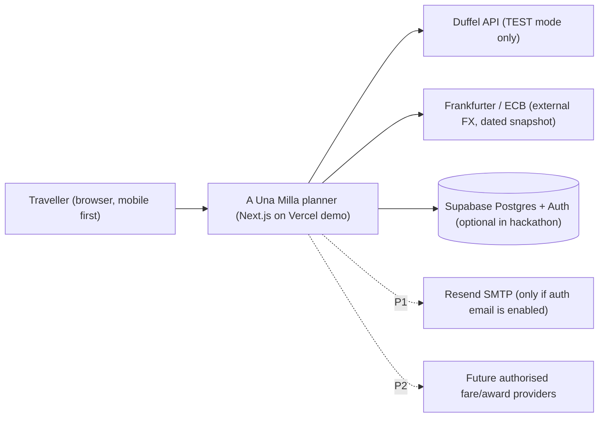
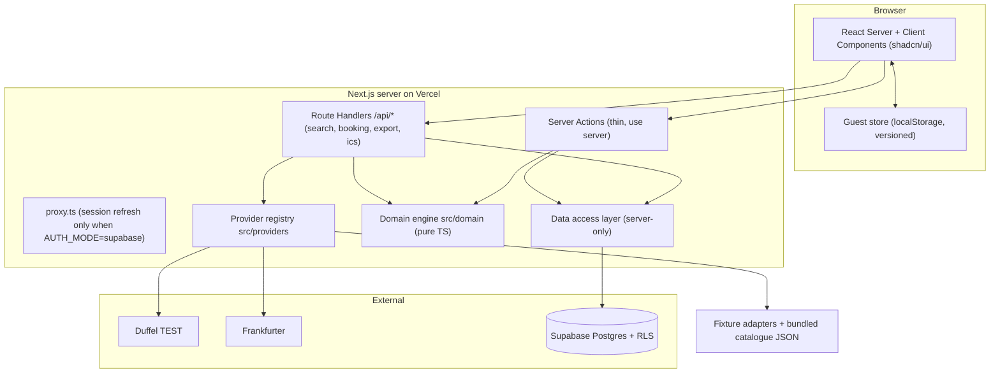

# Technical 01: Architecture and Stack Decision

| Field | Value |
|---|---|
| Status | Phase 2 technical blueprint, **documentation only**. Nothing here has been built or run. |
| Date | 26 Oct 2026 (baseline refreshed 18:47 IST) |
| Baseline | Phase 1 docs `../00`–`../03` and `../DISCOVERY_AUDIT_REPORT_2026-10-26.md` (immutable) |
| Entry point | [../../PROJECT_B_MASTER_PLAN.md](../../PROJECT_B_MASTER_PLAN.md) |

**Labels:** `[BRIEF]` `[OWNER]` `[CLIENT-GUIDE]` `[RESEARCH]` `[RECOMMENDATION]` `[ASSUMPTION]` `[OPEN QUESTION]` · Evidence: `[VERIFIED]` `[CONFLICTING]` `[UNVERIFIED]`.

---

## 1. System context



- `[OWNER]` The demo is hosted on **Vercel, on the owner's account**, as a non-commercial "sample live" deployment. It has no real users, payments, bookings or personal data (D-30, CONFIRMED).
- `[RESEARCH]` Duffel test mode is the only live connection. Its prices are not real market prices. No provider gives authorised award availability or award booking (Phase 1 RF-1, RF-3).

## 2. Option comparison (ADR-001)

| Criterion | **Option A: single Next.js 16 app** (Route Handlers + Server Actions, Supabase, pure TS domain) | **Option B: Next.js + NestJS 12 API + Postgres** |
|---|---|---|
| Requirements fit | Everything needed exists: server-side validation, DAL, provider adapters, RLS-enforced data access | Same capability; no requirement needs a separate API |
| Deadline (submission end of Wed 28 Oct) | One scaffold, one deploy, one CI pipeline | Second scaffold, CORS, auth handoff (JWT forwarding), second deploy; about +1 day (`[UNVERIFIED]` estimate) |
| Complexity | Low; the domain is isolated as a framework-free module | Higher; shared DTOs across two services |
| Free tier | One Vercel Hobby project + optional Supabase Free | A NestJS on Vercel becomes one function (`[VERIFIED]` vercel.com/docs/frameworks/backend/nestjs), or a second host |
| Testing | Vitest (domain, providers) + Playwright + pgTAP | The same plus API contract tests between the services |
| Security | One trust boundary (server code + RLS); secrets on one server | Two boundaries; more secrets surface |
| Upgrade path | The domain and providers can move into NestJS later (section 7) | Already split |
| Team skills | TypeScript throughout | TypeScript throughout |

**Decision (ADR-001) `[RECOMMENDATION]`:** **Option A.**
- The owner-supplied backend repository is used as the **database project** (migrations, RLS, pgTAP, seed). It is **not** a second application server (ADR-012).
- Option B is rejected for the MVP. It stays documented as the migration target if one of the section 7 triggers occurs.

## 3. Architecture



### 3.1 Server and client responsibilities

| Concern | Client | Server |
|---|---|---|
| Form state, inline validation (zod, same schema as the server) | ✓ | ✓ (authoritative) |
| Guest data persistence (guest mode) | ✓ localStorage | — (search is stateless) |
| Provider calls (Duffel, FX) | **Never** | ✓ (secrets server-only) |
| Money, points, verdict calculations | Display only | ✓ Engine runs on the server for all API responses. The same pure module may run client-side for instant "what if" previews; the server result is authoritative. |
| Authorisation | — | ✓ inside every Action/Route + RLS |
| Explanation text | Renders templates | Builds the explanation contract (ENG-21); optional LLM rephrase (flag off) |

### 3.2 Module boundaries (frontend repo)

| Module | Path | May import | Must not import |
|---|---|---|---|
| MOD-DOMAIN | `src/domain/**` | Only `src/domain/**`, `decimal.js`, `@date-fns/tz`, `date-fns` | `next`, `react`, `@supabase/*`, `@duffel/*`, `src/server`, `src/providers` (ESLint `no-restricted-imports`) |
| MOD-PROV | `src/providers/**` | `src/domain/types`, `@duffel/api`, `zod` | `react`, `next/*` UI code |
| MOD-SERVER | `src/server/**`, `src/app/api/**`, `*.action.ts` | Everything server-side; `server-only` import required | Client components |
| MOD-UI | `src/app/**` (pages), `src/components/**` | `src/domain` (types/pure functions), `src/lib/guest-store` | `src/server/**` except via actions; `src/providers` |
| MOD-GUEST | `src/lib/guest-store/**` | zod, domain types | Server code |
| MOD-I18N | `messages/en.json`, `src/i18n/**` | next-intl | — |
| MOD-FIXTURES | `src/fixtures/**` | domain types | Runtime import in prod paths unless `PROVIDER_MODE=fixture` (registry decides) |

Domain sub-modules (doc 05):
- `money`, `fx`, `valuation`, `savings`, `transfers`, `rules`, `allocation`, `multileg`, `forecast`, `availability`, `verdict`, `replan`, `explain`, `confidence`, `ranking`, `types`.

### 3.3 Data flow summary

All 14 flows are traced in doc 04 §7 and doc 11 §3.
- **Request path:** UI → zod (client) → Route/Action → zod (server) → auth + ownership (DAL) → providers (bounded time) → engine (pure) → DB transaction or RPC (authenticated mode) **or** response only (guest mode) → typed response with provenance.

## 4. Architectural decision records

| ADR | Decision | Status | Alternatives rejected (reason) |
|---|---|---|---|
| ADR-001 | Option A: single Next.js 16 app | `[RECOMMENDATION]`, pending owner approval in the master plan | Option B (section 2) |
| ADR-002 | Data access through supabase-js + `@supabase/ssr` with the **user's session**, so RLS always applies. Secret-key client only for the account-deletion routine and FX snapshot writes. | Provisional. `@supabase/ssr` is **beta** (`[VERIFIED]` supabase.com/docs/guides/auth/server-side), so it needs the TASK-003 runtime spike. | Drizzle/Prisma direct connection (bypasses RLS; Prisma `latest` is an RC) |
| ADR-003 | **Two auth modes.** `AUTH_MODE=guest` (hackathon default, D-29) and `AUTH_MODE=supabase` (enabled only after TASK-003 passes and credentials exist). Guest data stays local; one-time idempotent migration on sign-in. | Provisional (D-29) | Supabase anonymous sign-ins (30/hour/IP limit, needs CAPTCHA and cleanup): kept as a P1 option |
| ADR-004 | Money as integer minor units (`bigint` in DB, `number` safe-integer in TS with guards) + ISO currency; decimal.js only for FX/rate multiplication; half-away-from-zero at display | Recommended | Floats (precision); dinero.js (extra API surface for little gain) |
| ADR-005 | Provider registry with interfaces PRV-01..05 and a mandatory provenance category on every value (doc 04 §3) | Recommended | Direct SDK calls from routes (untestable, no mock mode) |
| ADR-006 | `PROVIDER_MODE` = `fixture` (default everywhere incl. CI) / `duffel_test` (demo URL only). Catalogue also bundled as JSON so the app works without Supabase. | Recommended | Live-only (would make the demo depend on external uptime) |
| ADR-007 | next-intl **without i18n routing** (single `en` locale, string catalogue); es-ES in P1 | Recommended. The Context7 snippet notes a possible next-intl/proxy interaction, so routing mode is avoided and TASK-002 must verify. | Hard-coded strings (blocks Spanish) |
| ADR-008 | Hosting: Vercel Hobby on the owner's account for the **non-commercial demo**. Netlify Free as technical fallback. Vercel Pro + Supabase Pro before any commercial use. | D-30 **CONFIRMED** by owner for the demo | Render/Cloudflare free (cold start, CPU limit) |
| ADR-009 | No scheduled jobs in P0 (reminders are computed on view + `.ics`). P1 uses Supabase pg_cron (Vercel Hobby cron is daily only). | Recommended | Inngest/Trigger.dev (extra service) |
| ADR-010 | LLM explanations behind `AI_EXPLANATIONS_ENABLED=false` by default; templates are always available; validator rejects new numbers or entities | D-20 CONFIRMED | LLM-generated numbers (forbidden) |
| ADR-011 | Version pinning and lockfile policy (section 5) | Recommended | Caret ranges / `latest` |
| ADR-012 | Two repositories: **frontend = whole Next.js app**, **backend = Supabase DB project** (section 6) | D-31 provisional | Monorepo (backend repo unused); NestJS in backend (Option B) |

## 5. Version-pinning policy and compatibility status (ADR-011)

**Policy**
- **Exact versions** in `package.json`: no `^` or `~` for runtime, build and test dependencies.
- `pnpm-lock.yaml` committed; CI uses `pnpm install --frozen-lockfile`.
- `"packageManager": "pnpm@10.32.1"`, `"engines": {"node": ">=24 <25"}`, `.nvmrc` = `24`.
- **Selection rule:** newest stable, never an RC or `latest` blindly, satisfying all engines and peer ranges.
- A set of individually valid versions is not proof of compatibility. Status stays **candidate** until TASK-002 passes:
  - `pnpm install`
  - `pnpm typecheck`
  - `pnpm lint`
  - `pnpm build`
  - 1 Vitest test
  - 1 Playwright test
- **Upgrades:** one package per commit, with the full gate re-run. Next.js security patch releases within 16.x are applied promptly.

**Compatibility table.** Versions from read-only `npm view`, 26 Oct 2026 18:47 IST. Node baseline: local v24.11.0; active LTS line 24.x (nodejs.org/dist/index.json).

| Package | Candidate pin | Engines / peers (from npm) | Status |
|---|---|---|---|
| next | 16.4.3 | node ≥20.9.0; peers react/react-dom ^19, @playwright/test ^1.51.1 (optional) | candidate |
| react, react-dom | 19.3.1 | satisfies next peer `^19.0.0` | candidate |
| typescript | **5.9.3** (latest 5.x; 7.0.2 avoided, Next 16 compatibility unverified) | node ≥14.17 | candidate |
| tailwindcss, @tailwindcss/postcss | 4.3.3 | — | candidate |
| shadcn (CLI, dev only) | 4.22.1 | node ≥20.18.1 | candidate |
| zod | 4.6.7 | — | candidate |
| next-intl | 4.14.9 | peer next ^12–^16, react ^19 | candidate |
| @supabase/supabase-js | 2.118.0 | node ≥22.0.0 | candidate |
| @supabase/ssr | 0.12.7 (**beta**) | peer supabase-js ^2.114.0 | candidate; runtime spike TASK-003 |
| supabase (CLI, dev, backend repo) | 2.122.0 | Docker needed for `start`, `test db`, `db dump` | candidate |
| vitest, @vitest/coverage-v8 | 5.0.5 | node ^22.12 \|\| ^24 \|\| ≥26; coverage peer vitest 5.0.5 | candidate |
| @playwright/test | 1.64.1 | node ≥20 | candidate |
| @axe-core/playwright | 4.14.0 | node ≥22.12; peer playwright-core | candidate |
| msw | 3.0.3 | node ≥22.12; peer typescript ≥5.9 (satisfied by 5.9.3) | candidate |
| @duffel/api | 4.31.0 | node ≥20 | candidate |
| decimal.js | 10.6.0 | — | candidate |
| date-fns / @date-fns/tz | 4.4.0 / 1.5.0 | — | candidate |
| ics | 3.12.1 | — | candidate |
| eslint / eslint-config-next | 10.13.0 / 16.4.3 | eslint node ^20.19 \|\| ^22.13 \|\| ≥24; config peer eslint ≥9 | candidate (eslint 10 + next config: verify in TASK-002) |
| prettier | 3.9.10 | — | candidate |
| lucide-react | 1.61.0 | — | candidate |
| server-only | 0.0.1 | — | candidate |
| Secret scanning | **gitleaks via Docker image** (`zricethezav/gitleaks`), not the unrelated npm package "gitleaks" | gitleaks is now security-patch-only (`[VERIFIED]` README) | candidate |

## 6. Repository layout (ADR-012, D-31 provisional; D-32)

| Workspace folder | Remote | Contents | Deploy |
|---|---|---|---|
| `frontend/` | `github.com/rishi-solanki-rs/hackathon-1-idea-2-Rishi-solanki-frontend` (empty, public, verified with `git ls-remote` returning no refs on 26 Oct 18:47) | Next.js app, domain, providers, fixtures, bundled catalogue JSON, tests, `messages/`, `docs/` mirror, CI | Vercel project (owner account) |
| `backend/` | `github.com/rishi-solanki-rs/hackathon-1-idea-2-Rishi-solanki-backend` (empty, public) | `supabase/config.toml`, `supabase/migrations/*.sql`, `supabase/seed.sql`, `supabase/tests/database/*.sql`, `scripts/backup.ps1|sh`, `scripts/gen-types`, `scripts/export-catalogue-json`, CI | Supabase Free project (optional) |

**Cross-repo contracts**
1. `backend/scripts/gen-types` produces `database.types.ts` with a header `schema_version: M0NN`. It is copied to `frontend/src/server/db/database.types.ts`. A mismatch between `schema_version` and the latest migration is a release blocker (checked manually in the hackathon; CI in P1).
2. `backend/scripts/export-catalogue-json` exports the seed catalogue to `frontend/src/fixtures/catalogue.json`, so guest/fixture mode uses **exactly** the same catalogue as the DB seed.
3. One main agent owns both repos' migrations, shared types and the catalogue export.

**Docs (D-32):**
- The canonical docs are written now in workspace `g:\Travel_hacking\docs\` (the root is not a repo).
- At TASK-000 they are copied into `frontend/docs/`; from then on the repo copy is canonical.
- They contain no secrets or private balances (checked by gitleaks).

**Frontend tree (planned)**

```
frontend/
  src/app/(public)/...          # SCR routes (doc 02)
  src/app/api/...               # API-* route handlers (doc 04)
  src/components/ui/            # shadcn (copied)
  src/components/app/           # CMP-* (doc 02)
  src/domain/                   # MOD-DOMAIN (doc 05)
  src/providers/                # PRV-* + registry.ts (doc 04)
  src/server/                   # dal/, actions/, auth/, ratelimit/, db/database.types.ts
  src/lib/guest-store/          # versioned local schema
  src/fixtures/                 # FX-*, CS-*, S-*, M-*, V*, REF-01, catalogue.json
  src/i18n/  messages/en.json
  tests/unit  tests/integration  tests/e2e
  proxy.ts                      # only active when AUTH_MODE=supabase
```

## 7. Future NestJS migration path

**Triggers** (any one): a second client (mobile app, partner API); long-running jobs beyond function limits; a separate team owning the backend; commercial requirements for an API product.

**Steps:**
1. Create `backend/api/` (NestJS 12) importing `src/domain` as a published internal package (`@aum/domain`).
2. Move the PRV-* adapters behind Nest providers.
3. Expose API-* contracts unchanged (same zod schemas via Standard Schema).
4. Point the Next.js Route Handlers at the API, or have the UI call it directly.
5. Keep Supabase Auth JWT verification in Nest guards.

The domain purity rule (section 3.2) makes this a move, not a rewrite.

## 8. Risks

| Risk | Mitigation |
|---|---|
| `@supabase/ssr` beta API change | Exact pin; TASK-003 spike; guest mode does not depend on it |
| Version set incompatibility (e.g. eslint 10 vs next config) | TASK-002 compatibility spike before feature work; fall back to the newest version that passes |
| Two-repo drift | `schema_version` stamp + catalogue export script + one owner |
| Vercel Hobby limits/terms | Non-commercial demo only; Netlify fallback documented (doc 08) |
