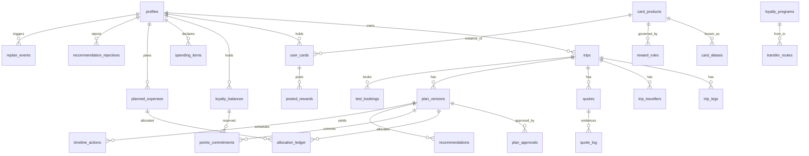

# Technical 03: Domain Model, Database and Migrations

| Field | Value |
|---|---|
| Status | Design only. **The SQL below is illustrative and has NOT been executed.** No migration has run, and no Supabase project is assumed to exist. |
| Repo | `backend/` (`hackathon-1-idea-2-Rishi-solanki-backend`): `supabase/migrations`, `seed.sql`, `tests/database` |
| Applies when | `AUTH_MODE=supabase` (authenticated mode). In guest-only mode (the D-29 default) user data stays in the browser, and only the catalogue is used, from bundled JSON exported from `seed.sql` (doc 01 §6). |

**Conventions**
- Money: `bigint` minor units + `char(3)` currency, with a check `currency ~ '^[A-Z]{3}$'`.
- Instants: `timestamptz` (UTC).
- Travel dates: `date` (airport-local), plus `tz text` (IANA).
- IDs: `uuid default gen_random_uuid()`.
- Client-generated `client_id uuid` on user rows for idempotent guest migration.
- Every user table gets `created_at` and `updated_at` (via trigger).
- **Supabase change of 30 Oct 2026:** new `public` tables get no Data API grants automatically, so **every migration states its GRANTs explicitly** (`[VERIFIED]` supabase.com/changelog/45329). RLS is enabled on every table. Policies use `(select auth.uid())` (`[VERIFIED]` Supabase RLS performance guidance).

---

## 1. ER overview



## 2. Ownership model (ADR-DB-01)

- **Every user-data table carries `user_id uuid not null references auth.users(id) on delete cascade`.**
- **Child tables also carry a composite foreign key** `(parent_id, user_id) references parent(id, user_id)`. The parent declares `unique (id, user_id)`.
  - A child row therefore cannot point at another user's parent, even when written by server code.
  - RLS can stay a single-column check, `(select auth.uid()) = user_id`, which is indexable and fast.
- **Alternative (documented, not chosen):** child policies with `exists (select 1 from parent p where p.id = parent_id and p.user_id = (select auth.uid()))`. It is slower and the same guarantee is weaker under server writes. It is rejected for the MVP.

## 3. Tables

### 3.1 Catalogue (read-only to clients; seeded by migrations from VERIFIED sources)

| TBL | Table | Key fields | Notes |
|---|---|---|---|
| TBL-01 | `airports` | `iata char(3) pk`, `name`, `city`, `country char(2)`, `tz text`, `metro_code` | Curated P0 list (MAD, BCN, AGP, SVQ, VLC, BIO, LIS, PEK, PVG, CAN, JNB, SCL, JFK, …) |
| TBL-02 | `loyalty_programs` | `id text pk`, `name`, `currency_kind ('airline','bank','fintech')`, `expiry_rule jsonb`, `release_window_days int null`, `release_status ('SECONDARY','UNKNOWN')`, `source_url`, `verified_at date` | Null release window → `UNKNOWN_AVAILABILITY` |
| TBL-03 | `transfer_routes` | `id`, `from_program`, `to_program`, `country_key char(2)`, `ratio_num int`, `ratio_den int`, `min_points int`, `increment int`, `max_delay_days int`, `min_account_age_days int`, `requires_link_via text null`, `status ('active','suspended')`, `evidence_status`, `source_url`, `verified_at` | E.g. MR ES → Iberia 1:1, min 50, 14 days; BA ↔ Iberia account age 90 days (stricter reading, CONFLICTING) |
| TBL-04 | `card_products` | `id text pk`, `canonical_name`, `issuer`, `country char(2)`, `currency_program`, `catalogue_status ('catalogue','template','custom_only','p1')`, `fee_minor bigint null`, `fee_period ('month','year')`, `fx_fee_bps int null`, `is_business bool`, `source_url`, `verified_at`, `unverified_fields text[]` | D-27 set (Phase 1 doc 00 §5.11) |
| TBL-05 | `card_aliases` | `alias text`, `card_product_id`; unique `lower(alias)` | "Iberia Icon Aire" → `iberia_aire`, etc. |
| TBL-06 | `reward_rules` | `id`, `card_product_id`, `rule_type ('RT-01'..'RT-06')`, `params jsonb` (rates by category, `cap_amount`, `cap_period`, `cap_scope ('rate_only','all_spend','ambiguous')`, threshold, window anchor, rounding, posting typical/max, reversal), `evidence_status`, `source_type`, `source_url`, `snapshot_hash`, `retrieved_at`, `valid_from`, `valid_to` | A new snapshot is a new row. Old rows are kept (history). |
| TBL-07 | `fx_rates` | `base`, `quote`, `rate numeric(18,8)`, `rate_date date`, `source ('ecb_frankfurter','fixture')`, pk `(base, quote, rate_date, source)` | Written server-side only (secret key) |

### 3.2 User data (authenticated mode)

| TBL | Table | Key fields / constraints |
|---|---|---|
| TBL-10 | `profiles` | `user_id pk`, `country char(2) default 'ES'`, `home_airports char(3)[]`, `locale default 'en'`, `objective ('B','A') default 'B'`, `tolerance jsonb`, `min_cash_reserve_minor bigint null` (required before M3 compute, D-05), `gates jsonb` (G2/G3 answers), `never_suggest_new_cards bool default false` |
| TBL-11 | `trips` | `id`, `user_id`, `client_id`, `kind ('quick','plan')`, `title`, `status ('draft','planned','booked_test','cancelled','archived')`, `objective`, `hard_deadline date null`, `user_cutoff_days int null`, `current_version_id uuid null`, `dedupe_key text` (normalised legs + dates + travellers hash), `deleted_at`; unique `(user_id, client_id)`; unique `(id, user_id)`; index `(user_id, status)` |
| TBL-12 | `trip_legs` | `id`, `trip_id`, `user_id`, `seq smallint check 1..6`, `origin`, `destination`, `date date`, `tz`, `flex jsonb`, `cabin`, `cabin_mode ('minimum','preferred')`, `booked bool default false`; FK `(trip_id, user_id)`; unique `(trip_id, seq)` |
| TBL-13 | `trip_travellers` | `id`, `trip_id`, `user_id`, `type ('adult','child','infant')`, `age smallint null`, `lap bool`, `responsible_adult_id uuid null`, `award_relationship ('member','beneficiary','companion','unknown')`; FK `(trip_id, user_id)`; check that age is required when the type isn't adult |
| TBL-14 | `quotes` | `id`, `trip_id`, `user_id`, `leg_ids uuid[]`, `kind ('cash','award','whole_trip')`, `provider ('duffel_test','fixture')`, `provider_ref text`, `provenance`, `availability_state`, `cash_out_minor`, `currency`, `points jsonb`, `conditions jsonb` (three-state), `fetched_at`, `expires_at`; FK `(trip_id, user_id)`; index `(trip_id, fetched_at desc)` |
| TBL-15 | `quote_log` | `id`, `user_id`, `trip_id`, `quote_ids uuid[]`, `savings_result jsonb`, `engine_version`, `created_at` (insert-only; substantiation, REQ-RES-12) |
| TBL-16 | `user_cards` | `id`, `user_id`, `client_id`, `card_product_id null`, `custom_terms jsonb null`, `nickname varchar(40)` (Luhn guard via check function), `issuing_country`, `opened_month date null`, `statement_day smallint null`, `credit_limit_minor bigint null`, `payment_prefs jsonb`, `plan_tier text null` (Revolut), `card_type ('debit','credit') null`, `is_business bool`; unique `(user_id, client_id)`; unique `(id, user_id)` |
| TBL-17 | `loyalty_balances` | `id`, `user_id`, `client_id`, `program_id`, `kind ('exact','range','unknown')`, `points int null`, `range_lo int null`, `range_hi int null`, `as_of date`, `expiry_date date null`, `account_opened date null`, `linked_via_ba bool null`, `details_match bool null`, `family_pool bool default false`; unique `(user_id, program_id)`; unique `(id, user_id)` |
| TBL-18 | `spending_items` | `id`, `user_id`, `client_id`, `category`, `amount_minor`, `frequency ('day','week','month')`, `monthly_minor bigint generated` (×365/12, ×52/12, rounded), `fixed_variable`, `current_card_id null`, `merchant_eligibility ('yes','no','unsure')`, `card_payable bool`; unique `(user_id, category)` (INV-7, one entry per category) |
| TBL-19 | `planned_expenses` | `id`, `user_id`, `client_id`, `description varchar(80)`, `amount_minor`, `currency`, `category`, `date_from`, `date_to null`, `movable bool`, `necessity ('necessary','optional','already_paid')`, `refundable ('yes','no','unknown')`, `status ('planned','done','refunded','cancelled')`; unique `(user_id, client_id)`; unique `(id, user_id)` |
| TBL-20 | `plan_versions` | `id`, `trip_id`, `user_id`, `version_no int`, `based_on_version_id null`, `inputs_snapshot jsonb`, `result jsonb`, `explanation jsonb`, `engine_version`, `reason text`, `event_id null`, `created_at`; unique `(trip_id, version_no)`; FK `(trip_id, user_id)`; **immutable** |
| TBL-21 | `plan_approvals` | `id`, `plan_version_id`, `user_id`, `approved_at`; unique `(plan_version_id)`; insert-only |
| TBL-22 | `allocation_ledger` | `id`, `plan_version_id`, `user_id`, `expense_ref uuid` (spending_item or planned_expense), `expense_kind`, `month date`, `user_card_id`, `amount_minor bigint` (negative = refund, INV-6), `points int`, `reason`; **unique `(plan_version_id, expense_ref, month)` where `amount_minor > 0` (INV-1)** |
| TBL-23 | `points_commitments` | `id`, `plan_version_id`, `user_id`, `balance_id`, `trip_id`, `points int check > 0`, `active bool`; enforced by RPC `commit_points` (INV-4); partial unique `(balance_id, trip_id) where active` |
| TBL-24 | `posted_rewards` | `id`, `user_id`, `user_card_id`, `month date`, `points int`, `source 'USER_ENTERED'`; unique `(user_card_id, month)` (REQ-REC-FCST-01) |
| TBL-25 | `recommendations` | `id`, `plan_version_id`, `user_id`, `kind`, `payload jsonb` (explanation contract), `status ('shown','accepted','rejected')` |
| TBL-26 | `recommendation_rejections` | `id`, `user_id`, `subject_kind ('card_product','strategy','award_option')`, `subject_id`, `scope ('trip','all','until_terms_change')`, `trip_id null`, `terms_hash null`; unique `(user_id, subject_kind, subject_id, coalesce(trip_id,'00000000-0000-0000-0000-000000000000'))` |
| TBL-27 | `replan_events` | `id`, `user_id`, `trip_id null`, `event_type ('R-EV-01'..'R-EV-14')`, `payload jsonb`, `idempotency_key text`, `based_on_version_id`, `processed_version_id null`, `created_at`; unique `(user_id, idempotency_key)` |
| TBL-28 | `timeline_actions` | `id`, `plan_version_id`, `user_id`, `kind`, `due_date`, `dedupe_key`; unique `(user_id, dedupe_key)` (T-TIME-011) |
| TBL-29 | `test_bookings` | `id`, `trip_id`, `user_id`, `provider 'duffel_test'`, `provider_order_id`, `booking_reference`, `total_minor`, `currency`, `idempotency_key`, `status`, `created_at`; unique `(provider, provider_order_id)`; unique `(user_id, idempotency_key)`. **No passenger PII stored.** |
| TBL-30 | `consents` | `id`, `user_id`, `kind ('analytics','email')`, `granted bool`, `at` |
| TBL-31 | `guest_migrations` | `id`, `user_id`, `migration_id uuid`, `status ('done','failed')`, `counts jsonb`, `at`; unique `(user_id, migration_id)` |
| TBL-32 | `rate_limits` | `key text`, `window_start timestamptz`, `count int`; pk `(key, window_start)`. **No client access.** |
| TBL-33 | `valuation_settings` | `id`, `user_id`, `program_id`, `method ('user','reference','break_even_only')`, `eur_per_point numeric(10,6) null`; unique `(user_id, program_id)` |

## 4. Permission matrix (GRANTs + RLS) for every table

Legend:
- **S/I/U/D** = SELECT / INSERT / UPDATE / DELETE.
- "own" = RLS `(select auth.uid()) = user_id`, `to authenticated`.
- "srv" = server-only through the secret-key client (bypasses RLS; used only in the named routines).
- "—" = no grant.
- `anon` has **no** grants on any user table.

| TBL | anon | authenticated | service_role (srv) | Notes |
|---|---|---|---|---|
| TBL-01 airports | S | S | S/I/U/D (migrations) | Catalogue |
| TBL-02 loyalty_programs | S | S | S/I/U/D | Catalogue |
| TBL-03 transfer_routes | S | S | S/I/U/D | Catalogue |
| TBL-04 card_products | S | S | S/I/U/D | Catalogue |
| TBL-05 card_aliases | S | S | S/I/U/D | Catalogue |
| TBL-06 reward_rules | S | S | S/I/U/D | Catalogue; history kept |
| TBL-07 fx_rates | S | S | S/I | Server writes snapshots |
| TBL-10 profiles | — | S/I/U own | S/D (account deletion) | No client DELETE (use API-30) |
| TBL-11 trips | — | S/I/U own (soft delete via `deleted_at`) | D | Hard delete only via account deletion |
| TBL-12 trip_legs | — | S/I/U/D own + composite FK | D | U blocked by trigger when `booked=true` |
| TBL-13 trip_travellers | — | S/I/U/D own + composite FK | D | |
| TBL-14 quotes | — | S/I own | D | No U (quotes are evidence) |
| TBL-15 quote_log | — | S/I own | D | Insert-only |
| TBL-16 user_cards | — | S/I/U/D own | D | |
| TBL-17 loyalty_balances | — | S/I/U/D own | D | |
| TBL-18 spending_items | — | S/I/U/D own | D | |
| TBL-19 planned_expenses | — | S/I/U own; D own only if `status='planned'` | D | Refund via RPC `record_refund` |
| TBL-20 plan_versions | — | **S, I own (via RPC `create_plan_version`)**; **no U, no D grant** | D (account deletion) | Immutable (REQ-NFR-07) |
| TBL-21 plan_approvals | — | S, I own | D | Insert-only |
| TBL-22 allocation_ledger | — | S own; **I only via RPC** | D | Unique constraint enforces INV-1 |
| TBL-23 points_commitments | — | S own; I/U only via RPC `commit_points` / `release_points` | D | Row lock prevents over-commitment |
| TBL-24 posted_rewards | — | S/I/U/D own | D | |
| TBL-25 recommendations | — | S own; I via RPC; U (`status`) own | D | |
| TBL-26 recommendation_rejections | — | S/I/D own | D | |
| TBL-27 replan_events | — | S/I own | D | Idempotency key |
| TBL-28 timeline_actions | — | S own; I via RPC | D | |
| TBL-29 test_bookings | — | S own; **I only by server route API-27 using the user's session** | D | |
| TBL-30 consents | — | S/I own | D | Append-only history |
| TBL-31 guest_migrations | — | S own; I via RPC `migrate_guest_data` | D | |
| TBL-32 rate_limits | — | — | S/I/U/D | Server-only |
| TBL-33 valuation_settings | — | S/I/U/D own | D | |

**Illustrative SQL pattern (not executed):**

```sql
-- user-owned table example
alter table public.trips enable row level security;
grant select, insert, update on public.trips to authenticated;       -- no delete grant
revoke all on public.trips from anon;
create policy trips_select_own on public.trips for select to authenticated
  using ((select auth.uid()) = user_id);
create policy trips_insert_own on public.trips for insert to authenticated
  with check ((select auth.uid()) = user_id);
create policy trips_update_own on public.trips for update to authenticated
  using ((select auth.uid()) = user_id) with check ((select auth.uid()) = user_id);
create index trips_user_status_idx on public.trips (user_id, status);

-- child table composite ownership
alter table public.trips add constraint trips_id_user_uq unique (id, user_id);
alter table public.trip_legs add constraint trip_legs_parent_fk
  foreign key (trip_id, user_id) references public.trips (id, user_id) on delete cascade;

-- immutable plan versions
grant select, insert on public.plan_versions to authenticated;       -- no update/delete
create policy pv_select_own on public.plan_versions for select to authenticated using ((select auth.uid()) = user_id);
create policy pv_insert_own on public.plan_versions for insert to authenticated with check ((select auth.uid()) = user_id);

-- catalogue
alter table public.card_products enable row level security;
grant select on public.card_products to anon, authenticated;
create policy card_products_read on public.card_products for select to anon, authenticated using (true);
```

## 5. Atomic operations (SQL functions, `security invoker`, so RLS applies)

| RPC | Purpose | Atomicity and idempotency |
|---|---|---|
| `create_plan_version(trip_id, based_on, inputs, result, explanation, ledger[], commitments[], actions[], event_id)` | Insert an immutable version plus its ledger, commitments and timeline in **one transaction** | `select … for update` on `trips` serialises versions per trip; `version_no = max+1`; ledger unique (INV-1); fails if `based_on ≠ trips.current_version_id` → client re-bases (CH-1, EC-TECH-08) |
| `commit_points(plan_version_id, balance_id, trip_id, points)` | Reserve points for one trip (INV-4) | Locks the `loyalty_balances` row; rejects if Σ active commitments + points > balance (`P0001 over_commitment`) |
| `release_points(commitment_id)` | Release on cancel or replan | Sets `active=false` |
| `record_refund(expense_id, amount_minor, idempotency_key)` | Refund → negative ledger entry + `replan_events` R-EV-02 (INV-6) | Unique `(user_id, idempotency_key)` on `replan_events` makes retries no-ops |
| `approve_plan(plan_version_id)` | Insert `plan_approvals`; set `trips.current_version_id` | Single transaction; unique per version |
| `migrate_guest_data(migration_id, payload jsonb)` | One-time import of guest trips, legs, balances, cards, spending, purchases | Unique `(user_id, migration_id)` → a second call returns the first result. Upsert on `(user_id, client_id)`; trip duplicates detected by `dedupe_key` and **reported, not merged silently**. All-or-nothing transaction; on error, rollback and the client keeps the local data. |
| `delete_account()` | **Server-only (srv)**, called by API-30 after re-auth | Deletes `auth.users` row → cascade; cancels timeline actions |

## 6. Migration sequence (backend repo; illustrative, not executed)

| # | Migration | Contents |
|---|---|---|
| M001 | `extensions_and_helpers` | `pgcrypto`, `updated_at` trigger fn, `luhn_guard(text)` check fn |
| M002 | `catalogue_core` | TBL-01..05 + grants + RLS |
| M003 | `reward_rules` | TBL-06 + grants + RLS |
| M004 | `fx_rates` | TBL-07 |
| M005 | `profiles_trips` | TBL-10..13 + composite FKs + booked-leg trigger |
| M006 | `quotes` | TBL-14, TBL-15 |
| M007 | `wallet_cards` | TBL-16, TBL-17, TBL-33 |
| M008 | `spending_purchases` | TBL-18, TBL-19 |
| M009 | `plans` | TBL-20, TBL-21, TBL-25, TBL-28 |
| M010 | `ledger_commitments` | TBL-22, TBL-23, TBL-24 |
| M011 | `events_rejections` | TBL-26, TBL-27 |
| M012 | `bookings_consents_migrations` | TBL-29, TBL-30, TBL-31 |
| M013 | `server_only` | TBL-32 (no grants to anon or authenticated) |
| M014 | `rpcs` | Section 5 functions; `grant execute` to authenticated except `delete_account` |
| seed | `seed.sql` | Catalogue rows from Phase 1 doc 00 §5.11 + FX-RULE-01, each with source and date |

**Rules:**
- Forward-only migrations, each with a "reversal notes" comment.
- Every migration must contain GRANT + RLS for every new table; the pgTAP check DB-001 enforces this.
- Back up before applying to any hosted project (doc 08 §5).

## 7. Database tests (pgTAP, `backend/supabase/tests/database/*.sql`, run with `supabase test db`, needs Docker; none run yet)

| DB test | Assertion | Phase 1 link |
|---|---|---|
| DB-001 | Every `public` table has RLS enabled and explicit grants (catalogue query over `pg_class` / `information_schema.role_table_grants`) | REQ-NFR-04 |
| DB-002 | `anon` has no privileges on TBL-10..33 | T-SEC-001 |
| DB-003 | User A cannot SELECT, UPDATE or DELETE user B's rows in **each** of TBL-10..31, 33 (parameterised over tables) | T-SEC-001 |
| DB-004 | User A cannot INSERT a child row (legs, travellers, quotes, ledger, commitments) whose parent belongs to user B (composite FK violation) | T-SEC-001 |
| DB-005 | `plan_versions` UPDATE and DELETE are denied to authenticated | T-REG-015 |
| DB-006 | Duplicate `(plan_version_id, expense_ref, month)` positive allocation is rejected | T-ALLOC-001 |
| DB-007 | `commit_points` rejects over-commitment under concurrent calls (two sessions) | T-ALLOC-004 |
| DB-008 | `record_refund` with the same idempotency key twice creates one entry | T-ALLOC-006, T-REG-002 |
| DB-009 | `migrate_guest_data` twice with the same `migration_id` is a no-op; a duplicate trip is reported | T-FLOW-017 |
| DB-010 | `migrate_guest_data` with an invalid payload rolls back completely | T-FLOW-017 |
| DB-011 | `create_plan_version` with stale `based_on` fails (re-base required) | T-REG-016 |
| DB-012 | Booked leg cannot be updated | T-REG-011 |
| DB-013 | Catalogue tables are read-only to anon and authenticated | REQ-REC-CAT-01 |
| DB-014 | `rate_limits` is inaccessible to clients | T-SEC-004 |
| DB-015 | Luhn guard rejects a 16-digit valid card number in `user_cards.nickname` | T-SEC-002 |
| DB-016 | Account deletion cascades and leaves no rows (incl. timeline actions) | T-SEC-006 |
| DB-017 | Unique `test_bookings (user_id, idempotency_key)` blocks double booking | T-SEC-009 |
| DB-018 | `timeline_actions` dedupe | T-TIME-011 |

## 8. Retention, export and deletion

- **Export (API-29):** JSON of every TBL-10..33 row for the user, via the user's session (RLS).
- **Delete (API-30):** re-authentication, then server-only `delete_account()`, which cascades.
- **Retention:** D-13 proposes deleting inactive accounts after 12 months. Keeping `quote_log` for substantiation conflicts with deletion, and that conflict is **flagged for legal review** (doc 06 §8).
- **Guest mode:** nothing stored server-side; "Clear local data" in SCR-14.
