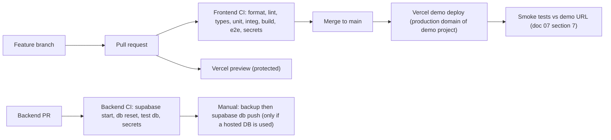

# Technical 08: Deployment, CI/CD, Costs and Upgrade Path

| Field | Value |
|---|---|
| Status | Plan only. **Nothing is deployed and no project or account was created or changed.** Plan terms were verified against official pages on 26 Oct 2026 and can change. |
| Owner decision | D-30 **CONFIRMED**: Vercel on the owner's account for a non-commercial demo, "sample live", nothing in real production use |

## 1. Environments

| Env | Where | `PROVIDER_MODE` | `AUTH_MODE` | Data | Purpose |
|---|---|---|---|---|---|
| Local | Developer machine (Windows, Node 24) | `fixture` (default) / `duffel_test` (manual) | `guest` | Fixtures; optional local Supabase via Docker | Development, tests |
| CI | GitHub Actions (public repos) | `fixture` | `guest` | Fixtures only; MSW blocks network; backend CI uses a local Supabase in Docker | Gates |
| Preview | Vercel preview deployments (per branch/PR) | `fixture` | `guest` | Fixtures | Review. **Protected by Vercel Authentication by default** (Standard Protection, `[VERIFIED]`), so only the owner sees them. |
| Demo (jury URL) | The Vercel project's production domain of the **demo project** (D-33 provisional) | `duffel_test` (falls back to `fixture` if the token is missing) | `guest` (D-29) | Fixtures + Duffel **test** | Public demo. Production domains are public by default under Standard Protection (`[VERIFIED]`). Labelled "DEMO". No real users, payments or bookings. |
| Optional demo DB | Supabase Free project "a-una-milla-demo" | — | `supabase` only if TASK-003 passes | Seed catalogue + test accounts only | Authenticated-mode demo |

**D-33 rationale.**
- The owner said nothing should go to real production. Using the **Production environment of a dedicated demo project** gives a stable public URL without changing preview protection settings.
- The alternative is disabling protection on a preview, which exposes every preview.
- To be confirmed by the owner. If the owner prefers previews, disable Deployment Protection only for the demo project (allowed on Hobby, `[VERIFIED]`).

## 2. Environment variables (names only)

| Name | Local | Preview | Demo | Secret? |
|---|---|---|---|---|
| `PROVIDER_MODE` | fixture | fixture | duffel_test | no |
| `AUTH_MODE` | guest | guest | guest | no |
| `DUFFEL_ACCESS_TOKEN` | optional (test) | — | test token | **yes** (Vercel "Secret" type) |
| `NEXT_PUBLIC_SUPABASE_URL` | optional | — | only if `AUTH_MODE=supabase` | no (public) |
| `NEXT_PUBLIC_SUPABASE_PUBLISHABLE_KEY` | optional | — | as above | no (public, RLS-protected) |
| `SUPABASE_SECRET_KEY` | optional | — | as above | **yes** |
| `AI_EXPLANATIONS_ENABLED` | false | false | false | no |
| `AI_PROVIDER_API_KEY` | — | — | — | yes (unused in P0) |
| `RATE_LIMIT_PER_MIN` | 10 | 10 | 10 | no |
| `APP_ENV_LABEL` | local | preview | demo | no |

**Rules**
- Vercel variables are scoped per environment, and changes apply only to new deployments (`[VERIFIED]`).
- `.env.example` in each repo lists names only.
- `vercel env pull` writes to a gitignored `.env.local`.

## 3. CI/CD

- **The frontend deploys via Vercel Git integration** for the owner's account. Connecting the repo requires the owner to authorise GitHub in Vercel (owner action).
- **The backend never auto-applies migrations to a hosted project.** Applying them is a manual, reviewed step: take a backup, run `supabase db push --linked`, then run the smoke tests.
- **Branch rule:** `main` is protected; PRs need green CI.
- **Hobby limits to keep in mind:** 1 concurrent build, 100 deployments/day, 45-minute build limit (`[VERIFIED]`).

## 4. Deployment procedure (demo)

1. Confirm green CI on `main` (frontend) and `db.yml` (backend, if the DB is used).
2. Vercel deploys automatically from the merge. Check the build log in the Vercel dashboard (or the Vercel MCP read-only, doc 10, with owner approval).
3. Run `BASE_URL=https://<demo-domain> pnpm test:smoke`.
4. Record the URL, commit SHA and results in `EVIDENCE.md`.
5. **Before the demo:**
   - wake the Supabase project, which pauses after 7 days of inactivity (`[VERIFIED]`);
   - check that `/api/health` shows the expected modes;
   - run the 3-minute script path (T-DEMO-004).

## 5. Rollback and recovery

| Failure | Action |
|---|---|
| Bad frontend deploy | Vercel Instant Rollback to the previous deployment (dashboard). Then revert the commit on `main`. |
| Duffel test outage | Set `PROVIDER_MODE=fixture` on the demo environment and redeploy. The UI shows "Simulated test booking". |
| Supabase unavailable or paused | Restore the project (paused projects can be restored for **up to 1 year**, `[VERIFIED]`); meanwhile `AUTH_MODE=guest` |
| Bad migration | Migrations are forward-only. Apply a corrective migration, or restore from backup (section 6). |
| Vercel unusable | Fallback host: Netlify (section 7). It needs a new site connection; the app needs no code change beyond the adapter defaults. |

## 6. Supabase Free backup and restore (no automatic backups on Free, `[VERIFIED]`)

**Backup** (from `backend/`, needs Docker and the CLI linked to the project):
- Schema: `supabase db dump --linked -f ../_backups/<date>/schema.sql`
- Data: `supabase db dump --linked --data-only -f ../_backups/<date>/data.sql`
- Roles (if needed): `supabase db dump --linked --role-only -f ../_backups/<date>/roles.sql`
- The `_backups/` folder sits **outside both repos** and is gitignored. Dumps may contain personal data, so they are never committed.
- **When:** before every migration, and daily while a hosted demo DB holds any non-fixture data.

**Restore drill** (at least once before the demo, if a hosted DB is used):
1. Create a fresh Supabase project, or use a local stack.
2. Apply `schema.sql`, then `data.sql` with `psql` using the project's connection string (taken from the dashboard, never written down).
3. Run `supabase test db` against the local copy and the smoke tests.

**Trigger to move to Supabase Pro ($25/month, daily backups for 7 days):** real users, any data that must not be lost, a need to never pause, or > 500 MB.

## 7. Hosting comparison (official terms, 26 Oct 2026)

| Host | Fit for this app | Commercial use on free | Key limits | Verdict |
|---|---|---|---|---|
| **Vercel Hobby** | First-class Next 16 (`proxy.ts`, Server Actions) | **No.** Non-commercial personal use only. Payments, advertising or being paid to build the site count as commercial (`[VERIFIED]` fair-use guidelines). | 300 s functions; 1M invocations; 4 h active CPU; cron at most daily; 1 h logs | **Chosen for the demo (D-30)** |
| **Netlify Free** | App Router, Server Actions, Route Handlers fully supported via the OpenNext adapter; Next 16 middleware/proxy fixes in adapter changelog 5.14–5.16 (`[VERIFIED]`); docs page doesn't name Next 16 explicitly | **Yes**, per Netlify's Free plan announcement (`[VERIFIED]`) | 300 credits/month; production deploy 15 credits (about 20/month); **all sites pause when credits run out** | Technical fallback, and the cheapest commercial-allowed free option. Monitor credits. |
| Vercel Pro | Same as Hobby | Yes | $20/month + $20 per extra seat | Commercial launch |
| Render / Cloudflare free | Cold starts / 10 ms CPU limit; experimental `proxy.ts` | — | — | Not recommended |

## 8. Costs (estimates; no invoices exist)

| Bucket | Items | Expected cost |
|---|---|---|
| 1. Hackathon demo | Vercel Hobby, Supabase Free (optional), Duffel **test** mode, Frankfurter (free, no key), GitHub public repos + Actions, gitleaks (free) | **€0** (`[ASSUMPTION]`: within free limits; no custom domain) |
| 2. Potential recurring production | Vercel Pro $20/month · Supabase Pro $25/month (+ PITR $100/month per 7 days if needed) · Resend Pro $20/month if > 3,000 emails or > 100/day · Sentry Team $26/month (optional) · PostHog free tier possible (EU region) | About **$45–$91/month** before usage overages (`[ASSUMPTION]`, list prices from official pages 26 Oct 2026) |
| 3. External provider charges | Duffel live: $3 per order + 1% managed content + $2 per paid ancillary + excess-search fees beyond 1,500 searches per booking + 2% FX. Live access needs business KYC. Award data (Seats.aero commercial / AwardTool): quote-based, needs an agreement. | Usage-based; **not incurred in the hackathon** |
| 4. Optional AI | Explanations off by default. If enabled with a small model: ~600 input + ~200 output tokens per explanation ≈ $0.0002 at $0.10/$0.50 per M tokens (Phase 1 tooling research) | Negligible at demo scale; cap with a monthly budget |

**No promise that the product stays free:** commercial use, real users or backups all require paid tiers.

## 9. Upgrade triggers and migration implications

| Trigger | Upgrade | Implementation impact |
|---|---|---|
| Any commercial use (payments, ads, affiliate links, paid client work) | Vercel Pro, or Netlify | Change team/plan only; no code change |
| Real users or data that must survive | Supabase Pro (backups); EU region review | No code change; review data residency (UNR-05) |
| Sign-in for real users | Custom SMTP (Resend) or OAuth | Config in Supabase Auth; TASK-003 must pass |
| Reminders more often than daily | Supabase pg_cron (P1) or Vercel Pro cron | Add jobs + dedupe keys (TBL-28) |
| Live fares or awards | Duffel live (KYC) / award data agreement | New adapters behind PRV-01/02 (doc 04); new provenance `VERIFIED_REAL_WORLD` |
| Second client or API product | NestJS service (doc 01 §7) | Move `src/domain` into a package |
| Traffic beyond Hobby/Free quotas | Paid tiers; DB-backed rate limits | Rate limit storage already designed (TBL-32) |

## 10. Official sources for free-tier and hosting claims (rechecked 26 Oct 2026)

The `[VERIFIED]` markers in this document refer to these official pages, re-read on 26 Oct 2026. Vendors change plans often, so recheck these pages at TASK-002 and before any launch decision.

| Claim | Official source |
|---|---|
| Hobby is non-commercial only; definition of commercial use; Hobby monthly guidelines (1M invocations, 4 h active CPU, 100 GB transfer) | [Vercel fair use guidelines](https://vercel.com/docs/limits/fair-use-guidelines) |
| Hobby: 100 deployments/day, 45-minute build, 300 s function maximum, cron limits | [Vercel limits](https://vercel.com/docs/limits) |
| Standard Protection covers previews but not production domains; available on all plans; Password Protection not available on Hobby | [Vercel Deployment Protection](https://vercel.com/docs/deployment-protection) |
| No automatic backups on Free; use `supabase db dump` for off-site backups | [Supabase database backups](https://supabase.com/docs/guides/platform/backups) |
| Free projects pause after low activity over 7 days; restorable for up to 1 year | [Supabase project pausing](https://supabase.com/docs/guides/platform/free-project-pausing) |
| Two active free projects; Pro: no pausing, automated backups | [Supabase billing FAQ](https://supabase.com/docs/guides/platform/billing-faq) |
| Netlify Free: 300 credits (hard limit), production deploy costs 15 credits | [Netlify pricing](https://www.netlify.com/pricing/), [Netlify credit-based plans](https://docs.netlify.com/manage/accounts-and-billing/billing/billing-for-credit-based-plans/credit-based-pricing-plans) |
| Netlify Free allows commercial projects | [Introducing Netlify's Free plan](https://www.netlify.com/blog/introducing-netlify-free-plan/) (Nov 2024, written before the Sept 2025 credit plans; recheck the current terms before relying on it) |
| Duffel test mode, offers and orders | [Duffel test mode](https://duffel.com/docs/api/overview/test-mode), [create order](https://duffel.com/docs/api/v2/orders/create-order), [pricing](https://duffel.com/pricing) |
